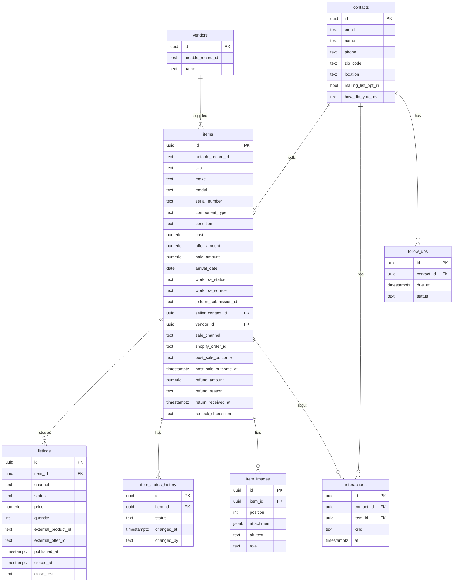

# AWS Postgres Database Plan

Status: draft, planning only. No code or AWS changes yet.

## Goal

Add an AWS-hosted Postgres database alongside Airtable, without disconnecting Airtable. Airtable stays the source of truth until a per-table cutover says otherwise. The long-term aim is a foundation for analytics dashboards and a CRM.

## Decisions

| Decision | Choice | Reason |
|---|---|---|
| Database | RDS Postgres, single-AZ `db.t4g.micro`, 7-day automated backups | CRM and analytics need joins, aggregation and flexible filtering. DynamoDB would force a data-model rewrite later. |
| Upgrade path | `t4g.small` first; Aurora only if usage grows well beyond the assumption below | Same Postgres code. Aurora and RDS Proxy are not needed unless usage changes. |
| Assumption | About 3 users total | Replicas, auto-scaling, multi-AZ and RDS Proxy are unnecessary. Revisit sizing if the team or load grows. |
| DynamoDB | Keep only for tokens, config, job state and idempotency keys | Already planned in `aws-lambda-migration-plan.md`. |
| Seam | `ListingStore` interface under the Lambda handlers | Frontend and `/api` contracts stay unchanged. |
| Rollout | Airtable default, then dual-write, shadow-read, per-table cutover | Airtable wiring stays intact during testing. |

## Current state (from code review)

- The browser never calls Airtable directly. Reads and writes go through `aws/src/providers/airtable/` (`client.ts`, `sources.ts`).
- Configured sources: `users`, `user-guide`, `inventory-directory`, `used-gear-workflow`, `approval-ebay`, `approval-shopify`, `approval-combined`, `shopify-vendors`.
- Server-side filtering is Airtable `filterByFormula` on `Workflow Status`, with subsets `ready-for-publishing`, `listings-page`, `post-publish`.
- There is a 120s in-memory cache and a 200-record cap on the listings page.
- Sorting and most extra filtering happen in the frontend.
- Records are `{id, fields, createdTime}` with human-labelled fields, string-typed values, and single-value arrays.

## Environment strategy

Airtable keeps working in `prod` and `staging` throughout. Only a dedicated test stack uses Postgres.

| Stage | `DATA_BACKEND` | Purpose |
|---|---|---|
| `prod` | `airtable` | Untouched. |
| `staging` | `airtable` | Stable test environment for normal code changes. |
| `pg-test` (new stage, copy of staging, or `dev`) | `dual`, then `postgres` | Only place the new database is exercised. Own RDS instance and stack. |

Rules:

- Stages are separate CloudFormation stacks (see `aws/samconfig.toml.example`). The flag and the RDS instance are per stack.
- An unset `DATA_BACKEND` means `airtable`, so stacks that don't opt in behave exactly as today.
- Merge the seam and Postgres store to `main` early, behind the flag. They are inert until enabled. Avoid a long-lived migration branch.
- Normal feature work continues on `main`. Backend-specific differences go behind the flag, not a fork.
- Shared contract tests run against both implementations, so Airtable changes that are not reflected in Postgres fail visibly.
- Postgres schema changes are versioned SQL migrations. The JSONB mirror absorbs new Airtable fields automatically.
- The `pg-test` stack uses the staging (test) Airtable base and its own secrets, never live production data.
  - Phase 0 finding: there is one production base, `apprsAm2FOohEmL2u`. A test copy (duplicated with records) now exists: `appKOs3hF99ZGBKK3`. `pg-test` must only ever point at this copy.
  - The duplicate has new table and view IDs, so `pg-test` must override every `AIRTABLE_*_TABLE_REF` / `_NAME` value. The code defaults hard-code production IDs (`sources.ts`).
  - Before use: confirm record counts match production and that automations in the copy are turned off.
  - Backups: Airtable base snapshot, the duplicate, and a local read-only JSON snapshot (`scripts/phase0-airtable-snapshot.mjs`, output in gitignored `backups/`).
- Rollback is setting the flag back to `airtable`.
- Backfill is one-way (Airtable to Postgres) until a later decision says otherwise.
- Use short-lived branches only for risky pieces (Postgres store, backfill), merged when tests pass.
- The frontend needs no change. An optional second CloudFront site can point at the `pg-test` API.

## Data model: two layers

### Layer 1: migration mirror (now)

One generic table per environment:

- `records(source text, record_id text, fields jsonb, created_time timestamptz, updated_at timestamptz, airtable_synced_at timestamptz, primary key (source, record_id))`
- Indexed or generated columns for hot fields only: `workflow_status`, `updated_at`.
- No redesign during migration, so diffs between Airtable and Postgres stay meaningful.

### Layer 2: normalized model (grow into it)

Populate from the mirror through a mapper, then move dashboards and CRM features onto it first.

| Today | Normalized |
|---|---|
| Seller fields repeated per workflow record | `contacts` (name, email, phone, zip, opt-in, source) |
| Item data spread across intake and approval tables | `items` (make, model, serial, condition, cost, acquired date) |
| Per-channel approval tables | `listings` (item_id, channel, status, price, external id, timestamps) |
| `Workflow Status` plus `... At` fields | `item_status_history` (item_id, status, changed_at, by) |
| String costs and dates | `numeric` and `timestamptz` |
| Single-item arrays | Scalars |
| New CRM | `interactions`, `inquiries`, `follow_ups` referencing `contacts` and `items` |

Highest-value change: `item_status_history`, which gives cycle-time and aging analytics directly.

## Risks and cautions

- Airtable field names are the current contract. The normalized layer needs an explicit mapping layer.
- Do not normalize before Phase 0 shows which fields are stable.
- Contact de-duplication needs explicit rules (for example, merge by email).
- Dual-write must never fail a request because the mirror failed.
- RDS adds a VPC, security groups and Lambda connectivity (small connection pools; RDS Proxy not needed at ~3 users). Local no-Docker flow needs a local Postgres.
- Cost: roughly $12 to $15 per month, always on. Keep encryption, private subnets and backups on regardless of team size.
- Airtable-specific types (linked records, formulas, rollups, attachments) have no Postgres equivalent. Decide per field: raw JSON or resolved.

## Checklist

Work one phase at a time. Do not start a phase until the previous one is signed off.

### Phase 0: Discovery (no code changes)

Status: complete, signed off 2026-10-21.

- [x] Confirm a separate Airtable test base exists for the `pg-test` stack so dual-write never touches live production data; record the answer in the Environment strategy section. If none exists, decide how to create one before Phase 5.
- [x] Get approximate record counts per source (from the owner's knowledge or a read-only Airtable API call; no writes).
- [x] List every source and its Airtable table, view and approximate record count.
- [x] Capture every field per source, with type, whether used, and which code reads or writes it.
- [x] Document read patterns: filters, sorts, search fields, subsets, max records.
- [x] Document write patterns: create, update, delete, attachment upload.
- [x] Identify linked-record, formula and attachment fields and decide handling.
- [x] Choose the first table to migrate (low risk, not live listings).
- [x] Decide attachment and image handling (keep Drive, Airtable and S3 as they are).
- [x] Draft the normalized schema (ER diagram) and review it.
- [x] Set a monthly budget and pick the dev/staging AWS account and region.

#### Phase 0 findings: sources (snapshot 2026-10-22, base `apprsAm2FOohEmL2u`)

There are nine configured sources (the plan's list of eight omitted `workflow-image-roles`). Source `inventory-directory` has no branch of its own and falls through to the Listings table.

| Source | Table | Table ID | Records |
|---|---|---|---|
| `approval-combined`, `used-gear-workflow`, `inventory-directory` | Listings (shared) | `tbl0K0nFQL64jQMx8` | 3,471 |
| `shopify-vendors` | Vendors | `tblF0B5TUhy20hJCv` | 646 |
| `user-guide` | User Guide | `tblquB9pdwSRXsI7c` | 65 |
| `workflow-image-roles` | Image Roles | `tblkoqoSKypAaZRZe` | 47 |
| `users` | Users | `tblj2Gt9USORo6Vi5` | 18 |
| `approval-shopify` | Shopify Listing | `tblqh6yC0p74UrHZo` | 3 |
| `approval-ebay` | Ebay Listing | `tbl3yTb0JkzUMFNnS` | 2 |
| none | Table 1 | `tblgA8olAJtkRNZvK` | 411 |
| none | Imported table | `tblYqqs0xvnSveIK0` | 0 |

Notes:

- Three sources share the Listings table, so the mirror key should be the physical table plus record ID, not just `source`.
- Field types: no linked-record, formula, rollup or lookup fields. Attachments are `Listings.Images`, `Image Roles.Attachments` and `Table 1.Images`. Read-only computed fields are two `lastModifiedTime` fields on Listings and one `aiText` field on Image Roles.

#### Phase 0 findings: fields

Full per-table inventory (name, type, code references): [airtable-field-inventory.md](./airtable-field-inventory.md). Generated from the read-only schema snapshot, so it contains no record data.

- Listings: 163 fields, 144 referenced by literal name in code. Unreferenced: template, eBay shipping and handling options, Shopify variant option fields, `Pick Up #`, `Submission Group ID`.
- Other tables: Users 9 of 9, User Guide 40 of 49, Vendors 1 of 1, Image Roles 2 of 6 (the role fields and `Attachments` are not referenced by literal name).
- `Imported table` has 494 text fields and 0 records, and is not used by any source. Exclude it from the mirror.
- References are by literal name only. The inventory does not distinguish reads from writes, and price and status variants resolved at runtime may show as unreferenced.

#### Phase 0 decisions: special field types and attachments

- No linked-record, formula, rollup or lookup fields exist, so there is nothing to resolve.
- Attachment fields (`Listings.Images`, `Image Roles.Attachments`, `Table 1.Images`): store the raw Airtable attachment JSON unchanged in the JSONB mirror. No files are copied and nothing changes in the Google Drive archive or the existing image flow. Airtable attachment URLs expire, so mirrored URLs are not durable while Airtable remains the source of truth. Durable storage (for example S3) stays a Phase 9 decision.
- Read-only computed fields (`lastModifiedTime` on Listings, `aiText` on Image Roles): store the value as read, never write it back to Airtable.

#### Phase 0 decision: first table

First table to migrate: **Vendors** (`shopify-vendors`, `tblF0B5TUhy20hJCv`). 646 records, one `singleLineText` field, no attachments, not live listings and not auth. Next candidates: User Guide (65 records), then Image Roles (47 records, has an attachment field). Avoid Users (tied to login) and Listings (3,471 records, 163 fields, live) until the pattern is proven.

#### Phase 0 decisions: budget, account and region

- Monthly budget for the Postgres work: **$25**, against an estimate of about $12 to $15 for single-AZ `db.t4g.micro` plus storage, backups and Secrets Manager. Add an AWS Budgets alert at about 80% in Phase 1.
- Account: the same AWS account as the existing stacks. Keep `pg-test` isolated through its own stack, secrets, RDS instance and the test Airtable base copy (`appKOs3hF99ZGBKK3`).
- Region: `us-east-1`, matching the existing dev, staging and prod stacks.

#### Phase 0 draft: normalized schema (for review)

Derived from the Listings field inventory. Each Listings row is one workflow record for one item, so Listings is split by concern. The mirror stays the source for the mapper. Nothing here is built before Phase 8.

Mapping from Listings fields:

| Target | Source fields |
|---|---|
| `contacts` | `Seller Email`, `Seller Phone`, `Seller Zip Code`, `Seller Location`, `How Did You Hear`, `Mailing List Opt In`. There is no seller name field, so de-duplicate by email. |
| `items` | `Make`, `Model`, `Serial Number`, `Component Type`, `Condition`, `Cost`, `Offer Amount`, `Paid Amount`, `Arrival Date`, `SKU`, `Workflow Status`, `Workflow Source`, `JotForm Submission ID`, `Vendor`, notes and inclusion fields |
| `listings` (one row per channel) | eBay: `Ebay Price`, `eBay Offer ID`, `eBay Listing ID`, `eBay Published At`, `eBay Closed At`, `eBay Close Result`. Shopify: `Shopify Price`, `Shopify REST Product ID`, `Shopify Inventory Quantity`, `Shopify Closed At`, `Shopify Close Result`. Listing content (titles, HTML bodies, categories, tags, shipping) stays in JSONB until needed. |
| `item_status_history` | `Workflow Status` plus the `... At` and `... Signed At` / `... By` fields: Accepted, Processing Signed, Testing Signed, Photography Signed, Pre-Listing Reviewed, Awaiting Pre-Listing Review At, Approved For Publish At, Listed At, Stale Listing At, Sold Ready To Ship At, Shipped At. History before migration can only be reconstructed from these timestamps. Later changes are recorded as they happen. |
| `item_images` | `Images` attachments (raw JSON), `Images Alt Text`, `Workflow Image Metadata JSON`, Image Roles table |
| `items` (sale columns) | `Shopify Order ID`, `Shopify Order Name`, `Post-Sale Outcome`, `Post-Sale Outcome At`, `Refund Amount`, `Refund Reason`, `Return Received At`, `Restock Disposition` |
| Stays JSONB in the mirror | Template, shipping dimension and fee fields, Shopify taxonomy and SEO fields, sync locks and webhook tracking fields, stale-recovery fields |

Review decisions:

- One Airtable Listings record is one physical item. The same item can be posted to both eBay and Shopify, which is why `listings` has one row per channel.
- Contact de-duplication matches on email only.
- `item_images` is a separate table (one item has many images). Sale and return fields stay as columns on `items`, since a sale is 1:1 with the item. Split them out later if one item can have several sales or returns.
- `Users`, `User Guide` and `Image Roles` stay as simple mirrored tables and are not normalized now.
- Costs and dates are strings or Airtable types today and become `numeric` and `timestamptz` in the normalized layer only.

#### Phase 0 findings: read patterns

Code: `aws/src/providers/airtable/sources.ts`, `handlers/airtable/getConfiguredRecords.ts`, `getConfiguredRecord.ts`, `getListings.ts`.

- **Operations:** list, get by ID, and a summary (`getConfiguredRecordsSummary`, which loads the whole source and counts approved vs pending using `Approved` / `Shopify Approved` / `eBay Approved`).
- **Readable sources:** all nine.
- **Pagination:** the client follows Airtable `offset` until done. There is no server-side sort; sorting happens in the frontend.
- **Options:** `fields` projection, `maxRecords` (1 to 1000), `filterByFormula`, `subset`, `searchQuery` + `searchFields`.
- **Subsets** (all filter on `Workflow Status`):
  - `ready-for-publishing` (`approval-combined` only): `Approved for Publish`.
  - `listings-page` (`approval-combined` only): Awaiting Pre-Listing Review, Approved for Publish, Listed Shopify/eBay, Stale Listing Shopify/eBay. Capped at 200 records.
  - `post-publish` (`used-gear-workflow` only): `USED_GEAR_POST_PUBLISH_STATUSES`, default fields `USED_GEAR_POST_PUBLISH_FIELDS` (`shared/contracts/usedGearPostPublish.ts`).
- **Search:** case-insensitive substring across the given fields, built as `SEARCH("q", LOWER({field}&""))`. Field names are resolved against table metadata (10-minute cache). Postgres equivalent: `ILIKE` over the JSONB fields.
- **Default projection:** approval sources use `DEFAULT_APPROVAL_QUEUE_FIELDS` (title, price, quantity, status and similar fields) unless the request sets `fields`.
- **Caching:** 120 s in-memory cache (`configuredRecordsCache.ts`), invalidated on every write.
- **Resilience:** unknown field names in `fields` are stripped and the call retried (10-minute cache of unknown fields).
- **Reference fallback:** with a `*_TABLE_REF`, candidate base/table/view combinations are tried in order. Single-record reads and writes retry on 401, 403 and 404.
- **Other readers:** auth (`providers/auth/users.ts`, reads `users`), Shopify and eBay preview and publish (`getConfiguredRecord`), Jotform backfill (`used-gear-workflow`), take-down (`used-gear-workflow`).
- **Metadata:** `getConfiguredFieldMetadata` (field schema) is available for `inventory-directory` and `used-gear-workflow` only. Phase 2 replaces it with a field-metadata table.

#### Phase 0 findings: write patterns

- **Create** (`createConfiguredRecord`, optional `typecast`): used by auth and by `upsertConfiguredRecord`.
- **Update** (`updateConfiguredRecord`, optional `typecast`): used by auth (login stamps and user upsert), Shopify publish (writes back the product ID), Jotform backfill, and `upsertConfiguredRecord`. It strips unknown fields and retries. It throws a 422 if a Shopify price field is unknown.
- **Delete** (`deleteConfiguredRecord`): allowed sources are `users`, `inventory-directory`, `used-gear-workflow`, `approval-ebay`, `approval-shopify`, `approval-combined`, `shopify-vendors`. Not allowed for `user-guide` and `workflow-image-roles`.
- **Upsert handler** (`upsertConfiguredRecord.ts`): create and update allowed for all nine sources.
- **Attachment upload** (`uploadConfiguredAttachment`): only `inventory-directory` and `used-gear-workflow`, and only fields `fldMXp0EaUHGglU8M` and `fld1zIzmZEciQECah`. The handler can also archive images to Google Drive.
- **Writes are partial updates by field name.** Every write clears the records cache. The mirror must apply the same partial-update behavior and preserve unknown fields.
- **Not covered:** there is no batch write and no transaction across tables.

### Phase 1: AWS foundation (no app changes)

- [x] Create the `pg-test` stage (samconfig entry and stack) pointing at the staging Airtable base; leave `prod` and `staging` on Airtable.
  - Done: `pg-test` template block added to `aws/samconfig.toml.example` (stack `airtable-shopify-ebay-pg-test`, `us-east-1`).
  - Test base verified (snapshot of `appKOs3hF99ZGBKK3`): same 9 tables, record counts, field IDs, table IDs and view IDs as production. Only the base ID differs, so `pg-test` needs the base ID overridden wherever a reference embeds it.
  - **Safety risk:** `sources.ts` hard-codes the production base `apprsAm2FOohEmL2u` in the default refs for `shopify-vendors` and `workflow-image-roles`. `template.yaml` has no parameter for `AIRTABLE_WORKFLOW_IMAGE_ROLES_TABLE_REF`, so a `pg-test` stack would read and write production for that source. Fix before any `pg-test` deploy: add the parameter and env var to `template.yaml`, and set every `*_TABLE_REF` explicitly to `appKOs3hF99ZGBKK3/<table>/<view>`.
  - Done: `aws/template.yaml` now has `AirtableWorkflowImageRolesTableRef` / `...TableName` parameters (default empty, so existing stacks behave exactly as before) wired to `AIRTABLE_WORKFLOW_IMAGE_ROLES_TABLE_REF` / `_NAME`. `sam validate --lint` passes. Not deployed. Note `AirtableShopifyVendorsTableRef` still defaults to the production base, so `pg-test` must override it too.
  - Done: `[pg-test.*]` section added to the local, gitignored `aws/samconfig.toml` (cloned from staging; backup in `backups/samconfig.toml.pre-pgtest`). It uses base `appKOs3hF99ZGBKK3` everywhere (no production base ID remains), explicit vendors and image-roles refs, `EnablePostgres=true`, the default-VPC ID and two subnets (us-east-1a and 1b), and `confirm_changeset = true`. Live Shopify, eBay, Jotform, Google and AI credentials are blank so `pg-test` cannot touch live services. The staging SSM path keys were dropped.
  - Remaining: replace `AirtableApiKey=REPLACE_WITH_TEST_BASE_READ_WRITE_TOKEN` with a new Airtable token scoped to the test base only. Not deployed.
  - Deployed 2026-10-21: stack `airtable-shopify-ebay-pg-test` is `CREATE_COMPLETE` (61 Lambdas, HTTP API, RDS `db.t4g.micro` Postgres 17.6, public, encrypted, deletion protection on). It took several attempts because the deployer user needed extra permissions; these live in a second IAM policy (`aws/deploy/sam-deployer-postgres-policy.example.json`) because the main policy hit the 6,144 character limit. A failed first create left an orphaned RDS instance that had to be deleted by hand because of deletion protection, so for future changes prefer stack updates over fresh creates.
- [x] Create the RDS Postgres instance in the `pg-test` stack (single-AZ `t4g.micro`, private subnets, encryption, 7-day automated backups). Drafted in `aws/template.yaml`, gated by `EnablePostgres` (default `false`); not deployed. Deviation: public endpoint instead of private subnets (see Lambda access below).
- [x] Store credentials in Secrets Manager. `PostgresSecret` generates a 40-character password; the instance reads it through a dynamic reference.
- [x] Define security groups and Lambda access (VPC config with small connection pools; no RDS Proxy). Decision: the instance has a public endpoint and Lambdas stay outside the VPC. Putting 61 Lambdas in a VPC needs a NAT (about $32/month with a gateway, about $3 to $4 with a NAT instance) for Airtable, Shopify, eBay and Google access, which breaks the $25 budget. Lambdas have no fixed IP, so the security group allows 5432 from anywhere and protection is forced TLS (`rds.force_ssl=1`), a generated password, encryption at rest and deletion protection. Revisit (private subnets plus NAT instance) before any `prod` use or real customer data beyond the test copy. Note the test base is a copy of production data.
- [x] Add the resources to `aws/template.yaml` and update the deployer IAM policy.
  - Done: resources added to `aws/template.yaml` (`PostgresSecret`, `PostgresSecurityGroup`, `PostgresSubnetGroup`, `PostgresParameterGroup`, `PostgresInstance`, outputs), all conditional on `EnablePostgres`. Parameters: `EnablePostgres`, `PostgresVpcId`, `PostgresSubnetIds` (two subnets in different AZs). Postgres 17.6, `postgres17` parameter group; `sam validate --lint` passes but confirm the version is available when deploying.
  - Done: `aws/deploy/sam-deployer-policy.example.json` now has four statements for RDS management (scoped to `airtable-shopify-ebay-*`), RDS describe, Secrets Manager and EC2 security group and subnet access.
  - Done: policy applied in IAM. Verified read-only that `resolutionavnyc` can now call `rds:DescribeDBEngineVersions` and `ec2:DescribeVpcs`.
  - Verified: Postgres 17.5 to 17.11 are available in `us-east-1`, so `17.6` is valid. The account has a default VPC, `vpc-07b7e525a1e7e83a5`, with public subnets in six AZs. Suggested `pg-test` values: `PostgresVpcId=vpc-07b7e525a1e7e83a5`, `PostgresSubnetIds=subnet-052666462438dbf5b,subnet-0fcb2c534d16c8fdc` (us-east-1a and 1b).
- [ ] Verify connectivity from a throwaway Lambda and from a local script.
- [ ] Decide on the local dev database (Docker Postgres or the dev instance).

### Phase 2: Schema and migrations

- [ ] Choose a migration tool or plain SQL-files runner.
- [ ] Create the `records` mirror table and the hot-field indexes.
- [ ] Create a field-metadata table or equivalent to replace `getTableMetadata`.
- [ ] Apply migrations in dev and verify idempotency.

### Phase 3: Code seam (Airtable behavior unchanged)

- [ ] Extract the `ListingStore` interface from the current Airtable client operations.
- [ ] Wrap the existing Airtable implementation behind it.
- [ ] Add the `DATA_BACKEND` flag (`airtable` | `dual` | `postgres`), default `airtable`, settable per source.
- [ ] Add shared contract tests that any implementation must pass.
- [ ] Confirm existing tests and local `/api` validation still pass.

### Phase 4: Postgres implementation and backfill

- [ ] Implement the Postgres `ListingStore` (list, get, create, update, delete, subsets, search).
- [ ] Run the contract tests against Postgres.
- [ ] Write an idempotent Airtable-to-Postgres backfill script with row-count reporting.
- [ ] Backfill dev data and diff counts and fields.

### Phase 5: Shadow write

- [ ] Enable `dual` for the first table.
- [ ] Mirror writes to Postgres after Airtable succeeds; log and meter mirror failures without failing requests.
- [ ] Run the write-validation workflow in `aws-lambda-write-validation.md`.
- [ ] Review failure logs and fix gaps.

### Phase 6: Shadow read

- [ ] Read from both backends, serve Airtable, and log mismatches.
- [ ] Fix drift until diffs are zero for an agreed period.
- [ ] Measure latency of both paths.

### Phase 7: Per-table cutover

- [ ] Switch reads to Postgres for one table; keep Airtable writes in place.
- [ ] Confirm rollback is a single flag change and test it.
- [ ] Consider reverse sync until confident.
- [ ] Repeat per table.

### Phase 8: Normalized layer and CRM foundations

- [ ] Build the mapper from the mirror to normalized tables (`contacts`, `items`, `listings`, `item_status_history`).
- [ ] Define and test contact de-duplication rules.
- [ ] Move the first dashboard onto normalized tables.
- [ ] Add CRM tables (`interactions`, `inquiries`, `follow_ups`).

### Phase 9: Later decisions (not now)

- [ ] Attachments and images storage.
- [ ] Auth and user records.
- [ ] Retiring Airtable.
- [ ] Instance upgrade (`t4g.small`), and only if usage outgrows the 3-user assumption: Aurora, read replica, or Athena for heavy reporting.

## Out of scope

- Disconnecting Airtable.
- Changing frontend behavior or `/api` contracts.
- Moving Shopify or eBay integrations.
