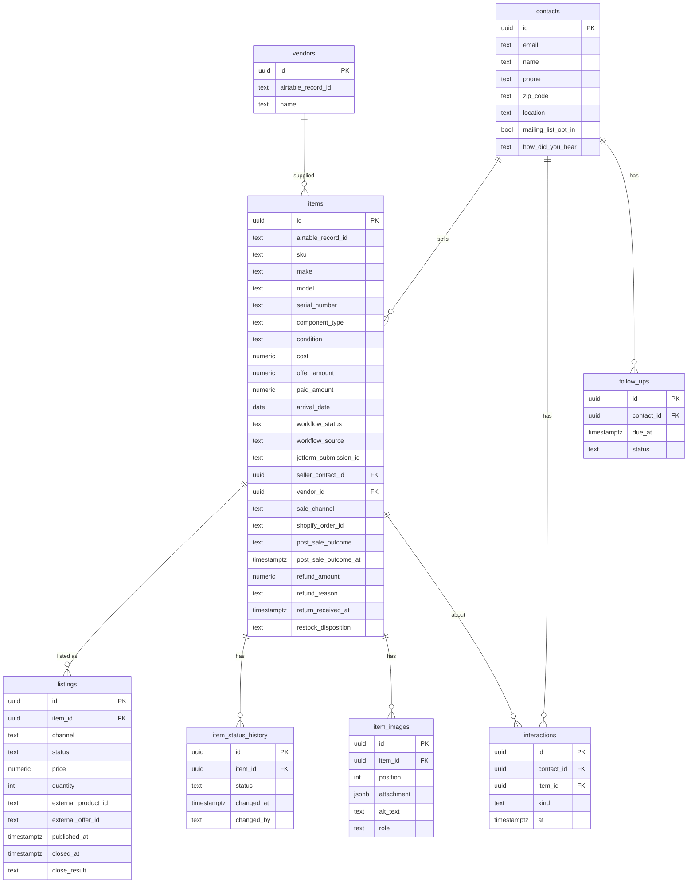

# AWS Postgres Database Plan

Status: draft, planning only. No code or AWS changes yet.

## Goal

Add an AWS-hosted Postgres database alongside Airtable, without disconnecting Airtable. Airtable stays the source of truth until a per-table cutover says otherwise. The long-term aim is a foundation for analytics dashboards and a CRM.

## Decisions

| Decision | Choice | Reason |
|---|---|---|
| Database | RDS Postgres, single-AZ `db.t4g.micro`, 7-day automated backups | CRM and analytics need joins, aggregation and flexible filtering. DynamoDB would force a data-model rewrite later. |
| Upgrade path | `t4g.small` first; Aurora only if usage grows well beyond the assumption below | Same Postgres code. Aurora and RDS Proxy are not needed unless usage changes. |
| Assumption | About 3 users total | Replicas, auto-scaling, multi-AZ and RDS Proxy are unnecessary. Revisit sizing if the team or load grows. |
| DynamoDB | Keep only for tokens, config, job state and idempotency keys | Already planned in `aws-lambda-migration-plan.md`. |
| Seam | `ListingStore` interface under the Lambda handlers | Frontend and `/api` contracts stay unchanged. |
| Rollout | Airtable default, then dual-write, shadow-read, per-table cutover | Airtable wiring stays intact during testing. |

## Current state (from code review)

- The browser never calls Airtable directly. Reads and writes go through `aws/src/providers/airtable/` (`client.ts`, `sources.ts`).
- Configured sources: `users`, `user-guide`, `inventory-directory`, `used-gear-workflow`, `approval-ebay`, `approval-shopify`, `approval-combined`, `shopify-vendors`.
- Server-side filtering is Airtable `filterByFormula` on `Workflow Status`, with subsets `ready-for-publishing`, `listings-page`, `post-publish`.
- There is a 120s in-memory cache and a 200-record cap on the listings page.
- Sorting and most extra filtering happen in the frontend.
- Records are `{id, fields, createdTime}` with human-labelled fields, string-typed values, and single-value arrays.

## Environment strategy

Airtable keeps working in `prod` and `staging` throughout. Only a dedicated test stack uses Postgres.

| Stage | `DATA_BACKEND` | Purpose |
|---|---|---|
| `prod` | `airtable` | Untouched. |
| `staging` | `airtable` | Stable test environment for normal code changes. |
| `pg-test` (new stage, copy of staging, or `dev`) | `dual`, then `postgres` | Only place the new database is exercised. Own RDS instance and stack. |

Rules:

- Stages are separate CloudFormation stacks (see `aws/samconfig.toml.example`). The flag and the RDS instance are per stack.
- An unset `DATA_BACKEND` means `airtable`, so stacks that don't opt in behave exactly as today.
- Merge the seam and Postgres store to `main` early, behind the flag. They are inert until enabled. Avoid a long-lived migration branch.
- Normal feature work continues on `main`. Backend-specific differences go behind the flag, not a fork.
- Shared contract tests run against both implementations, so Airtable changes that are not reflected in Postgres fail visibly.
- Postgres schema changes are versioned SQL migrations. The JSONB mirror absorbs new Airtable fields automatically.
- The `pg-test` stack uses the staging (test) Airtable base and its own secrets, never live production data.
  - Phase 0 finding: there is one production base, `apprsAm2FOohEmL2u`. A test copy (duplicated with records) now exists: `appKOs3hF99ZGBKK3`. `pg-test` must only ever point at this copy.
  - The duplicate has new table and view IDs, so `pg-test` must override every `AIRTABLE_*_TABLE_REF` / `_NAME` value. The code defaults hard-code production IDs (`sources.ts`).
  - Before use: confirm record counts match production and that automations in the copy are turned off.
  - Backups: Airtable base snapshot, the duplicate, and a local read-only JSON snapshot (`scripts/phase0-airtable-snapshot.mjs`, output in gitignored `backups/`).
- Rollback is setting the flag back to `airtable`.
- Backfill is one-way (Airtable to Postgres) until a later decision says otherwise.
- Use short-lived branches only for risky pieces (Postgres store, backfill), merged when tests pass.
- The frontend needs no change. An optional second CloudFront site can point at the `pg-test` API.

## Data model: two layers

### Layer 1: migration mirror (now)

One generic table per environment:

- `records(source text, record_id text, fields jsonb, created_time timestamptz, updated_at timestamptz, airtable_synced_at timestamptz, primary key (source, record_id))`
- Indexed or generated columns for hot fields only: `workflow_status`, `updated_at`.
- No redesign during migration, so diffs between Airtable and Postgres stay meaningful.

### Layer 2: normalized model (grow into it)

Populate from the mirror through a mapper, then move dashboards and CRM features onto it first.

| Today | Normalized |
|---|---|
| Seller fields repeated per workflow record | `contacts` (name, email, phone, zip, opt-in, source) |
| Item data spread across intake and approval tables | `items` (make, model, serial, condition, cost, acquired date) |
| Per-channel approval tables | `listings` (item_id, channel, status, price, external id, timestamps) |
| `Workflow Status` plus `... At` fields | `item_status_history` (item_id, status, changed_at, by) |
| String costs and dates | `numeric` and `timestamptz` |
| Single-item arrays | Scalars |
| New CRM | `interactions`, `inquiries`, `follow_ups` referencing `contacts` and `items` |

Highest-value change: `item_status_history`, which gives cycle-time and aging analytics directly.

## Risks and cautions

- Airtable field names are the current contract. The normalized layer needs an explicit mapping layer.
- Do not normalize before Phase 0 shows which fields are stable.
- Contact de-duplication needs explicit rules (for example, merge by email).
- Dual-write must never fail a request because the mirror failed.
- RDS adds a VPC, security groups and Lambda connectivity (small connection pools; RDS Proxy not needed at ~3 users). Local no-Docker flow needs a local Postgres.
- Cost: roughly $12 to $15 per month, always on. Keep encryption, private subnets and backups on regardless of team size.
- Airtable-specific types (linked records, formulas, rollups, attachments) have no Postgres equivalent. Decide per field: raw JSON or resolved.

## Checklist

Work one phase at a time. Do not start a phase until the previous one is signed off.

### Phase 0: Discovery (no code changes)

Status: complete, signed off 2026-10-21.

- [x] Confirm a separate Airtable test base exists for the `pg-test` stack so dual-write never touches live production data; record the answer in the Environment strategy section. If none exists, decide how to create one before Phase 5.
- [x] Get approximate record counts per source (from the owner's knowledge or a read-only Airtable API call; no writes).
- [x] List every source and its Airtable table, view and approximate record count.
- [x] Capture every field per source, with type, whether used, and which code reads or writes it.
- [x] Document read patterns: filters, sorts, search fields, subsets, max records.
- [x] Document write patterns: create, update, delete, attachment upload.
- [x] Identify linked-record, formula and attachment fields and decide handling.
- [x] Choose the first table to migrate (low risk, not live listings).
- [x] Decide attachment and image handling (keep Drive, Airtable and S3 as they are).
- [x] Draft the normalized schema (ER diagram) and review it.
- [x] Set a monthly budget and pick the dev/staging AWS account and region.

#### Phase 0 findings: sources (snapshot 2026-10-22, base `apprsAm2FOohEmL2u`)

There are nine configured sources (the plan's list of eight omitted `workflow-image-roles`). Source `inventory-directory` has no branch of its own and falls through to the Listings table.

| Source | Table | Table ID | Records |
|---|---|---|---|
| `approval-combined`, `used-gear-workflow`, `inventory-directory` | Listings (shared) | `tbl0K0nFQL64jQMx8` | 3,471 |
| `shopify-vendors` | Vendors | `tblF0B5TUhy20hJCv` | 646 |
| `user-guide` | User Guide | `tblquB9pdwSRXsI7c` | 65 |
| `workflow-image-roles` | Image Roles | `tblkoqoSKypAaZRZe` | 47 |
| `users` | Users | `tblj2Gt9USORo6Vi5` | 18 |
| `approval-shopify` | Shopify Listing | `tblqh6yC0p74UrHZo` | 3 |
| `approval-ebay` | Ebay Listing | `tbl3yTb0JkzUMFNnS` | 2 |
| none | Table 1 | `tblgA8olAJtkRNZvK` | 411 |
| none | Imported table | `tblYqqs0xvnSveIK0` | 0 |

Notes:

- Three sources share the Listings table, so the mirror key should be the physical table plus record ID, not just `source`.
- Field types: no linked-record, formula, rollup or lookup fields. Attachments are `Listings.Images`, `Image Roles.Attachments` and `Table 1.Images`. Read-only computed fields are two `lastModifiedTime` fields on Listings and one `aiText` field on Image Roles.

#### Phase 0 findings: fields

Full per-table inventory (name, type, code references): [airtable-field-inventory.md](./airtable-field-inventory.md). Generated from the read-only schema snapshot, so it contains no record data.

- Listings: 163 fields, 144 referenced by literal name in code. Unreferenced: template, eBay shipping and handling options, Shopify variant option fields, `Pick Up #`, `Submission Group ID`.
- Other tables: Users 9 of 9, User Guide 40 of 49, Vendors 1 of 1, Image Roles 2 of 6 (the role fields and `Attachments` are not referenced by literal name).
- `Imported table` has 494 text fields and 0 records, and is not used by any source. Exclude it from the mirror.
- References are by literal name only. The inventory does not distinguish reads from writes, and price and status variants resolved at runtime may show as unreferenced.

#### Phase 0 decisions: special field types and attachments

- No linked-record, formula, rollup or lookup fields exist, so there is nothing to resolve.
- Attachment fields (`Listings.Images`, `Image Roles.Attachments`, `Table 1.Images`): store the raw Airtable attachment JSON unchanged in the JSONB mirror. No files are copied and nothing changes in the Google Drive archive or the existing image flow. Airtable attachment URLs expire, so mirrored URLs are not durable while Airtable remains the source of truth. Durable storage (for example S3) stays a Phase 9 decision.
- Read-only computed fields (`lastModifiedTime` on Listings, `aiText` on Image Roles): store the value as read, never write it back to Airtable.

#### Phase 0 decision: first table

First table to migrate: **Vendors** (`shopify-vendors`, `tblF0B5TUhy20hJCv`). 646 records, one `singleLineText` field, no attachments, not live listings and not auth. Next candidates: User Guide (65 records), then Image Roles (47 records, has an attachment field). Avoid Users (tied to login) and Listings (3,471 records, 163 fields, live) until the pattern is proven.

#### Phase 0 decisions: budget, account and region

- Monthly budget for the Postgres work: **$25**, against an estimate of about $12 to $15 for single-AZ `db.t4g.micro` plus storage, backups and Secrets Manager. Add an AWS Budgets alert at about 80% in Phase 1.
- Account: the same AWS account as the existing stacks. Keep `pg-test` isolated through its own stack, secrets, RDS instance and the test Airtable base copy (`appKOs3hF99ZGBKK3`).
- Region: `us-east-1`, matching the existing dev, staging and prod stacks.

#### Phase 0 draft: normalized schema (for review)

Derived from the Listings field inventory. Each Listings row is one workflow record for one item, so Listings is split by concern. The mirror stays the source for the mapper. Nothing here is built before Phase 8.

Mapping from Listings fields:

| Target | Source fields |
|---|---|
| `contacts` | `Seller Email`, `Seller Phone`, `Seller Zip Code`, `Seller Location`, `How Did You Hear`, `Mailing List Opt In`. There is no seller name field, so de-duplicate by email. |
| `items` | `Make`, `Model`, `Serial Number`, `Component Type`, `Condition`, `Cost`, `Offer Amount`, `Paid Amount`, `Arrival Date`, `SKU`, `Workflow Status`, `Workflow Source`, `JotForm Submission ID`, `Vendor`, notes and inclusion fields |
| `listings` (one row per channel) | eBay: `Ebay Price`, `eBay Offer ID`, `eBay Listing ID`, `eBay Published At`, `eBay Closed At`, `eBay Close Result`. Shopify: `Shopify Price`, `Shopify REST Product ID`, `Shopify Inventory Quantity`, `Shopify Closed At`, `Shopify Close Result`. Listing content (titles, HTML bodies, categories, tags, shipping) stays in JSONB until needed. |
| `item_status_history` | `Workflow Status` plus the `... At` and `... Signed At` / `... By` fields: Accepted, Processing Signed, Testing Signed, Photography Signed, Pre-Listing Reviewed, Awaiting Pre-Listing Review At, Approved For Publish At, Listed At, Stale Listing At, Sold Ready To Ship At, Shipped At. History before migration can only be reconstructed from these timestamps. Later changes are recorded as they happen. |
| `item_images` | `Images` attachments (raw JSON), `Images Alt Text`, `Workflow Image Metadata JSON`, Image Roles table |
| `items` (sale columns) | `Shopify Order ID`, `Shopify Order Name`, `Post-Sale Outcome`, `Post-Sale Outcome At`, `Refund Amount`, `Refund Reason`, `Return Received At`, `Restock Disposition` |
| Stays JSONB in the mirror | Template, shipping dimension and fee fields, Shopify taxonomy and SEO fields, sync locks and webhook tracking fields, stale-recovery fields |

Review decisions:

- One Airtable Listings record is one physical item. The same item can be posted to both eBay and Shopify, which is why `listings` has one row per channel.
- Contact de-duplication matches on email only.
- `item_images` is a separate table (one item has many images). Sale and return fields stay as columns on `items`, since a sale is 1:1 with the item. Split them out later if one item can have several sales or returns.
- `Users`, `User Guide` and `Image Roles` stay as simple mirrored tables and are not normalized now.
- Costs and dates are strings or Airtable types today and become `numeric` and `timestamptz` in the normalized layer only.

#### Phase 0 findings: read patterns

Code: `aws/src/providers/airtable/sources.ts`, `handlers/airtable/getConfiguredRecords.ts`, `getConfiguredRecord.ts`, `getListings.ts`.

- **Operations:** list, get by ID, and a summary (`getConfiguredRecordsSummary`, which loads the whole source and counts approved vs pending using `Approved` / `Shopify Approved` / `eBay Approved`).
- **Readable sources:** all nine.
- **Pagination:** the client follows Airtable `offset` until done. There is no server-side sort; sorting happens in the frontend.
- **Options:** `fields` projection, `maxRecords` (1 to 1000), `filterByFormula`, `subset`, `searchQuery` + `searchFields`.
- **Subsets** (all filter on `Workflow Status`):
  - `ready-for-publishing` (`approval-combined` only): `Approved for Publish`.
  - `listings-page` (`approval-combined` only): Awaiting Pre-Listing Review, Approved for Publish, Listed Shopify/eBay, Stale Listing Shopify/eBay. Capped at 200 records.
  - `post-publish` (`used-gear-workflow` only): `USED_GEAR_POST_PUBLISH_STATUSES`, default fields `USED_GEAR_POST_PUBLISH_FIELDS` (`shared/contracts/usedGearPostPublish.ts`).
- **Search:** case-insensitive substring across the given fields, built as `SEARCH("q", LOWER({field}&""))`. Field names are resolved against table metadata (10-minute cache). Postgres equivalent: `ILIKE` over the JSONB fields.
- **Default projection:** approval sources use `DEFAULT_APPROVAL_QUEUE_FIELDS` (title, price, quantity, status and similar fields) unless the request sets `fields`.
- **Caching:** 120 s in-memory cache (`configuredRecordsCache.ts`), invalidated on every write.
- **Resilience:** unknown field names in `fields` are stripped and the call retried (10-minute cache of unknown fields).
- **Reference fallback:** with a `*_TABLE_REF`, candidate base/table/view combinations are tried in order. Single-record reads and writes retry on 401, 403 and 404.
- **Other readers:** auth (`providers/auth/users.ts`, reads `users`), Shopify and eBay preview and publish (`getConfiguredRecord`), Jotform backfill (`used-gear-workflow`), take-down (`used-gear-workflow`).
- **Metadata:** `getConfiguredFieldMetadata` (field schema) is available for `inventory-directory` and `used-gear-workflow` only. Phase 2 replaces it with a field-metadata table.

#### Phase 0 findings: write patterns

- **Create** (`createConfiguredRecord`, optional `typecast`): used by auth and by `upsertConfiguredRecord`.
- **Update** (`updateConfiguredRecord`, optional `typecast`): used by auth (login stamps and user upsert), Shopify publish (writes back the product ID), Jotform backfill, and `upsertConfiguredRecord`. It strips unknown fields and retries. It throws a 422 if a Shopify price field is unknown.
- **Delete** (`deleteConfiguredRecord`): allowed sources are `users`, `inventory-directory`, `used-gear-workflow`, `approval-ebay`, `approval-shopify`, `approval-combined`, `shopify-vendors`. Not allowed for `user-guide` and `workflow-image-roles`.
- **Upsert handler** (`upsertConfiguredRecord.ts`): create and update allowed for all nine sources.
- **Attachment upload** (`uploadConfiguredAttachment`): only `inventory-directory` and `used-gear-workflow`, and only fields `fldMXp0EaUHGglU8M` and `fld1zIzmZEciQECah`. The handler can also archive images to Google Drive.
- **Writes are partial updates by field name.** Every write clears the records cache. The mirror must apply the same partial-update behavior and preserve unknown fields.
- **Not covered:** there is no batch write and no transaction across tables.

### Phase 1: AWS foundation (no app changes)

Status: complete, signed off 2026-10-21. **Done 2026-10-23: the user created the $25/month budget with an alert in the Billing console (not verifiable from the deployer user).** Original follow-up: create an AWS Budgets alert at about 80% of the $25/month budget (Billing console). The pg-test RDS instance has been billing since 2026-10-21.

- [x] Create the `pg-test` stage (samconfig entry and stack) pointing at the staging Airtable base; leave `prod` and `staging` on Airtable.
  - Done: `pg-test` template block added to `aws/samconfig.toml.example` (stack `airtable-shopify-ebay-pg-test`, `us-east-1`).
  - Test base verified (snapshot of `appKOs3hF99ZGBKK3`): same 9 tables, record counts, field IDs, table IDs and view IDs as production. Only the base ID differs, so `pg-test` needs the base ID overridden wherever a reference embeds it.
  - **Safety risk:** `sources.ts` hard-codes the production base `apprsAm2FOohEmL2u` in the default refs for `shopify-vendors` and `workflow-image-roles`. `template.yaml` has no parameter for `AIRTABLE_WORKFLOW_IMAGE_ROLES_TABLE_REF`, so a `pg-test` stack would read and write production for that source. Fix before any `pg-test` deploy: add the parameter and env var to `template.yaml`, and set every `*_TABLE_REF` explicitly to `appKOs3hF99ZGBKK3/<table>/<view>`.
  - Done: `aws/template.yaml` now has `AirtableWorkflowImageRolesTableRef` / `...TableName` parameters (default empty, so existing stacks behave exactly as before) wired to `AIRTABLE_WORKFLOW_IMAGE_ROLES_TABLE_REF` / `_NAME`. `sam validate --lint` passes. Not deployed. Note `AirtableShopifyVendorsTableRef` still defaults to the production base, so `pg-test` must override it too.
  - Done: `[pg-test.*]` section added to the local, gitignored `aws/samconfig.toml` (cloned from staging; backup in `backups/samconfig.toml.pre-pgtest`). It uses base `appKOs3hF99ZGBKK3` everywhere (no production base ID remains), explicit vendors and image-roles refs, `EnablePostgres=true`, the default-VPC ID and two subnets (us-east-1a and 1b), and `confirm_changeset = true`. Live Shopify, eBay, Jotform, Google and AI credentials are blank so `pg-test` cannot touch live services. The staging SSM path keys were dropped.
  - Remaining: replace `AirtableApiKey=REPLACE_WITH_TEST_BASE_READ_WRITE_TOKEN` with a new Airtable token scoped to the test base only. Not deployed.
  - Deployed 2026-10-21: stack `airtable-shopify-ebay-pg-test` is `CREATE_COMPLETE` (61 Lambdas, HTTP API, RDS `db.t4g.micro` Postgres 17.6, public, encrypted, deletion protection on). It took several attempts because the deployer user needed extra permissions; these live in a second IAM policy (`aws/deploy/sam-deployer-postgres-policy.example.json`) because the main policy hit the 6,144 character limit. A failed first create left an orphaned RDS instance that had to be deleted by hand because of deletion protection, so for future changes prefer stack updates over fresh creates.
- [x] Create the RDS Postgres instance in the `pg-test` stack (single-AZ `t4g.micro`, private subnets, encryption, 7-day automated backups). Drafted in `aws/template.yaml`, gated by `EnablePostgres` (default `false`); not deployed. Deviation: public endpoint instead of private subnets (see Lambda access below).
- [x] Store credentials in Secrets Manager. `PostgresSecret` generates a 40-character password; the instance reads it through a dynamic reference.
- [x] Define security groups and Lambda access (VPC config with small connection pools; no RDS Proxy). Decision: the instance has a public endpoint and Lambdas stay outside the VPC. Putting 61 Lambdas in a VPC needs a NAT (about $32/month with a gateway, about $3 to $4 with a NAT instance) for Airtable, Shopify, eBay and Google access, which breaks the $25 budget. Lambdas have no fixed IP, so the security group allows 5432 from anywhere and protection is forced TLS (`rds.force_ssl=1`), a generated password, encryption at rest and deletion protection. Revisit (private subnets plus NAT instance) before any `prod` use or real customer data beyond the test copy. Note the test base is a copy of production data.
- [x] Add the resources to `aws/template.yaml` and update the deployer IAM policy.
  - Done: resources added to `aws/template.yaml` (`PostgresSecret`, `PostgresSecurityGroup`, `PostgresSubnetGroup`, `PostgresParameterGroup`, `PostgresInstance`, outputs), all conditional on `EnablePostgres`. Parameters: `EnablePostgres`, `PostgresVpcId`, `PostgresSubnetIds` (two subnets in different AZs). Postgres 17.6, `postgres17` parameter group; `sam validate --lint` passes but confirm the version is available when deploying.
  - Done: `aws/deploy/sam-deployer-policy.example.json` now has four statements for RDS management (scoped to `airtable-shopify-ebay-*`), RDS describe, Secrets Manager and EC2 security group and subnet access.
  - Done: policy applied in IAM. Verified read-only that `resolutionavnyc` can now call `rds:DescribeDBEngineVersions` and `ec2:DescribeVpcs`.
  - Verified: Postgres 17.5 to 17.11 are available in `us-east-1`, so `17.6` is valid. The account has a default VPC, `vpc-07b7e525a1e7e83a5`, with public subnets in six AZs. Suggested `pg-test` values: `PostgresVpcId=vpc-07b7e525a1e7e83a5`, `PostgresSubnetIds=subnet-052666462438dbf5b,subnet-0fcb2c534d16c8fdc` (us-east-1a and 1b).
- [x] Verify connectivity from a throwaway Lambda and from a local script.
  - Local script: done 2026-10-21. Connected to `appdb` over TLS (PostgreSQL 17.6, `ssl=on`), and a plaintext connection was refused. Password read from Secrets Manager at run time, never printed or stored.
  - Lambda: not tested with a throwaway function. Lambdas run outside the VPC and reach the same public endpoint, so the network path is the same. Still to do in Phase 3: bundle `pg` and grant the Lambda role `secretsmanager:GetSecretValue` on the secret. Confirm it with the first real Lambda that connects.
- [x] Decide on the local dev database (Docker Postgres or the dev instance).
  - Decision: local Docker Postgres 17 (same major as RDS, no cost, no shared state). Docker is not installed on this machine yet, so the compose file is added in Phase 2 alongside the migration tool. `pg-test` RDS is only for deployed-stack testing.

### Phase 2: Schema and migrations

Status: complete, signed off 2026-10-21.

- [x] Choose a migration tool or plain SQL-files runner.
  - Decision: plain numbered SQL files in `aws/db/migrations/` plus a small runner (`aws/src/db/migrator.ts`, `npm run db:migrate` with `DATABASE_URL`). Records applied versions and checksums in `schema_migrations`, takes an advisory lock, runs each file in a transaction, and refuses to run if an applied file was edited. Only new dependency: `pg`.
- [x] Create the `records` mirror table and the hot-field indexes.
  - `0001_records_mirror.sql`: `records(base_id, table_id, record_id)` primary key (physical table, not source), `fields jsonb`, `airtable_created_at`, `synced_at`, soft-delete `deleted_at`. Hot-field indexes on `Workflow Status` and lower-cased `Email`. Text search (`SEARCH` formulas) is not indexed yet; decide in Phase 4 when the Postgres read path exists.
- [x] Create a field-metadata table or equivalent to replace `getTableMetadata`.
  - `0002_airtable_fields.sql`: `airtable_fields(base_id, table_id, field_id, name, type, options jsonb)`, same shape as `getTableMetadata`. Populated by the backfill in Phase 4.
- [x] Apply migrations in dev and verify idempotency.
  - Verified 2026-10-21 on a scratch database on the `pg-test` RDS instance (Docker is not installed): first run applied 0001 and 0002, second run applied none. Scratch database dropped. Applied to the real `appdb` on `pg-test` on 2026-10-21 (0001, 0002); re-run applied none. Unit tests for the runner pass (`npm test`).

### Phase 3: Code seam (Airtable behavior unchanged)

Status: complete, signed off 2026-10-21.

- [x] Extract the `ListingStore` interface from the current Airtable client operations.
  - `aws/src/store/listingStore.ts`: 8 methods (`getRecords`, `getRecordsSummary`, `getRecord`, `createRecord`, `updateRecord`, `deleteRecord`, `getFieldMetadata`, `uploadAttachment`), mirroring the existing `*Configured*` functions. Source-level policy (which sources may delete or upload) stays in the handlers.
- [x] Wrap the existing Airtable implementation behind it.
  - `airtableListingStore` delegates to the unchanged `providers/airtable/sources.ts`. `store/index.ts` re-exports the same function names, so the 12 callers (handlers and `crossChannelClose`) changed only their import path.
- [x] Add the `DATA_BACKEND` flag (`airtable` | `dual` | `postgres`), default `airtable`, settable per source.
  - `DATA_BACKEND` (default `airtable`) plus `DATA_BACKEND_OVERRIDES` (`source=backend,source=backend`) for per-source settings. Template parameters `DataBackend` and `DataBackendOverrides` default to `airtable` / empty. `dual` and `postgres` return HTTP 501 `DATA_BACKEND_NOT_IMPLEMENTED` until Phase 4/6, and invalid values return 500, so a typo never silently falls back.
- [x] Add shared contract tests that any implementation must pass.
  - `store/listingStore.contract.ts` (`runListingStoreContract`) covers create/get, update merge, delete, `maxRecords` and field projection, summary, field metadata and the attachment allow-list. The Airtable store runs it against an in-memory fake of the Airtable client. Filter and search semantics are not in the contract yet because they need the Postgres implementation to compare against (Phase 4).
- [x] Confirm existing tests and local `/api` validation still pass.
  - `aws` typecheck and `npm test` pass (17 tests). The full root AWS suite (`tests/unit/aws`, 438 tests) passes before and after the change. `npm run local:api:check` is OK. Note: `npm run test:aws` only runs 5 tests because its unquoted `**` glob is not recursive in `sh`; run `node --import tsx --import ./tests/unit/aws/network-guard.ts --test $(find tests/unit/aws -name '*.test.ts')` for the full suite.

### Phase 4: Postgres implementation and backfill

Status: complete, signed off 2026-10-21.

- [x] Implement the Postgres `ListingStore` (list, get, create, update, delete, subsets, search).
  - `aws/src/store/postgresListingStore.ts` (`createPostgresListingStore`), not yet wired into `getListingStore` (that is Phase 5/6, so behavior is unchanged). Reads the `records` mirror keyed by physical base and table, resolved through the new `resolveConfiguredSourceTable` in `sources.ts`. Subsets share their status lists with the Airtable code (`resolveSubsetStatuses`).
  - Differences from Airtable to keep in mind: no `filterByFormula` beyond the three auth equality shapes (`{F} = "x"`, `LOWER({F}) = "x"`), anything else is HTTP 400; search is a case-insensitive substring over the requested fields on the raw JSON value (arrays and objects are matched as JSON text, no index yet); results are ordered by creation time then id, not Airtable view order; delete is a soft delete; writing `null` removes a field; created ids are `rec` plus 14 random characters; attachment upload returns HTTP 501 until a storage decision is made.
- [x] Run the contract tests against Postgres.
  - `postgresListingStore.test.ts` runs the shared contract plus subset, search, auth-formula, null-clear and soft-delete cases. It needs `POSTGRES_TEST_URL` (a scratch Postgres) and is skipped otherwise. 11 of 11 passed on a scratch database on `pg-test` (dropped afterward). The contract has a new `attachments: 'not-implemented'` mode for backends that cannot store attachments yet.
- [x] Write an idempotent Airtable-to-Postgres backfill script with row-count reporting.
  - `aws/src/db/backfill.ts` and `backfill-cli.ts` (`npm run db:backfill -- --base appKOs3hF99ZGBKK3 [--tables ...] [--apply]`). Default is a dry run (Airtable GET only, counts only). `--apply` upserts `records` and `airtable_fields` in one transaction per table, soft-deletes rows missing from a full read, and reports Airtable vs Postgres counts. Refuses the production base without `--allow-production-read`. Verified 2026-10-21: dry run on the test base matched the Phase 0 counts; `--apply` on a scratch database on `pg-test` loaded 4,252 records and 294 fields with counts matching Airtable per table, and a second run was idempotent (0 inserted, all updated). Scratch database dropped.
- [x] Backfill dev data and diff counts and fields.
  - 2026-10-21: backfilled the test base (`appKOs3hF99ZGBKK3`) into `appdb` on `pg-test`: 4,252 records across 7 tables. Counts match Airtable per table, and a deep comparison of every record's fields found 0 differences.

### Phase 5: Shadow write

Status: signed off 2026-10-22.

- [x] Enable `dual` for the first table.
  - 2026-10-21: `pg-test` stack updated (`UPDATE_COMPLETE`, 61 functions and the API modified, none replaced) with `DataBackend=airtable` and `DataBackendOverrides=shopify-vendors=dual`. `pg-test` points only at the Airtable test base. The shopify-vendors reference there was checked to use the test base, not production.
- [x] Mirror writes to Postgres after Airtable succeeds; log and meter mirror failures without failing requests.
  - Code written and tested locally, not deployed. `store/dualListingStore.ts` reads from Airtable only; create, update, delete and attachment upload write to Airtable first, then mirror Airtable's returned record into `records` through `store/postgresMirror.ts` (same ids and fields). A mirror failure is logged as `postgres_mirror_failed` plus a CloudWatch EMF metric `AirtableShopifyEbay/DataBackend` `PostgresMirrorFailure` (dimensions Source, Operation), and never fails the request. An Airtable failure skips the mirror. `getListingStore` returns it for `dual`; `postgres` is still 501.
  - `template.yaml` Globals now sets `DATABASE_URL` (only when `EnablePostgres` is true, otherwise empty) from the Secrets Manager password and RDS endpoint. Note this puts the DB password in the Lambda environment configuration, the same way the Airtable and Shopify secrets are passed today. `db/pool.ts` uses 3 s connect and 5 s query timeouts so a slow database cannot stall a request.
  - Tests: 5 unit tests with fakes, plus a gated Postgres mirror test. All 34 `aws` tests pass against a scratch database; the root suite still passes 438.
- [x] Run the write-validation workflow in `aws-lambda-write-validation.md`.
  - The documented probe targets the local API and does not cover `shopify-vendors`, and deployed routes need a logged-in session. Instead I ran the same store code locally against the Airtable test base and the `pg-test` database (`DATA_BACKEND_OVERRIDES=shopify-vendors=dual`): create, update and delete of one temporary `PG-DUAL-PROBE-*` Vendors row. After each step the Postgres row matched Airtable's record exactly, and delete removed it from Airtable and soft-deleted it in Postgres. The temporary Airtable row is gone (Vendors is back to 646); one soft-deleted row remains in `appdb` and is reconciled by the next backfill. Still to do: exercise `dual` through the deployed API with a real login (for example editing a vendor in the deployed `pg-test` UI).
- [x] Review failure logs and fix gaps.
  - Done 2026-10-22. A vendor created through the deployed `pg-test` API (approval form Vendor field) landed in Airtable and was mirrored to `records` within about a second. No `postgres_mirror_failed` entries in the create function logs. The test vendor was then deleted from the Airtable test base and soft-deleted in Postgres.
  - Found while testing: against the full-size test base, `used-gear-workflow` (no row cap) and `approval-combined` reads return HTTP 500 because the Lambda response exceeds the 6 MB limit. These are Airtable-only reads, unrelated to `dual`. Not yet checked whether staging or production hit the same limit. Look at this separately before any read cutover.

### Phase 6: Shadow read

Status: signed off 2026-10-22. Deployed to `pg-test`.

- [x] Read from both backends, serve Airtable, and log mismatches.
  - Code done 2026-10-22 (`aws/src/store/shadowRead.ts`, `dualListingStore.ts`, wired in `index.ts`). In `dual` mode, `getRecords` and `getRecord` return Airtable's answer, then read Postgres (3 s timeout, awaited because Lambda freezes unfinished work) and compare by record id, ignoring order and null fields. Capped reads (`maxRecords`) compare only the count and shared rows. Logs `postgres_shadow_read` (field names only, never values) plus EMF metrics `ShadowReadMismatch`, `ShadowReadError`, `AirtableReadMs`, `PostgresReadMs` by Source and Operation. Outcomes: match, mismatch, unsupported (formula Postgres can't run), timeout, error. 4 new tests; `aws` suite passes. Deployed to `pg-test` 2026-10-22 (13 resources modified, none replaced). First real reads through the deployed API (`shopify-vendors`, `getRecords`): both matched exactly, 646 vs 646 records, zero field differences. Latency: Airtable about 1.16 to 1.19 s, Postgres about 0.28 to 0.31 s (includes a cold connection).
- [x] Fix drift until diffs are zero for an agreed period.
  - Agreed period (2026-10-22): short, a few manual checks on the test stack only. Revisit with a longer window when staging or prod runs `dual`. Local read-only checks against the test base and `pg-test` Postgres (vendors): full list 646/646, three single-record reads, `maxRecords=10`, a search (95/95) and a field-projected read all matched with zero field differences.
- [x] Measure latency of both paths.
  - Deployed Lambda, vendors full list: Airtable about 1.2 s vs Postgres about 0.3 s. Local single-record reads: about 140 ms vs 63 ms. Metrics `AirtableReadMs` and `PostgresReadMs` are emitted per read for later comparison. Shadow reads add the Postgres time to each dual read, so they should be removed or sampled once Phase 7 starts.

### Phase 7: Per-table cutover

Status: closed 2026-10-23. Cut over: `shopify-vendors`, `user-guide`. Reverse sync deferred (only needed once writes move to Postgres). Follow-ups, each blocked as noted below: `users`, `workflow-image-roles`, listing tables.

- [x] Switch reads to Postgres for one table; keep Airtable writes in place.
  - Code and tests done 2026-10-22: new backend value `postgres-read` (`aws/src/store/postgresReadListingStore.ts`). Reads (`getRecords`, `getRecord`, `getRecordsSummary`) come from Postgres. Writes and attachments still go Airtable-first and are mirrored to Postgres (the `dual` write path), and field metadata stays on Airtable. If a Postgres read fails for any reason (unsupported formula, missing row, database down), it falls back to Airtable and logs `postgres_read_fallback` plus metric `PostgresReadFallback`. `postgres` stays 501 until writes move. 3 new tests; `aws` suite passes (29 passed, 1 skipped). Deployed to `pg-test` 2026-10-22 (62 resources modified, none replaced; `DataBackendOverrides=shopify-vendors=postgres-read`). A logged-in vendor list read through the deployed API returned 646 vendors with no `postgres_read_fallback` entries and no shadow-read lines (so the Postgres path served it).
- [x] Confirm rollback is a single flag change and test it.
  - Tested 2026-10-22 on `pg-test`: changing only `DataBackendOverrides` from `shopify-vendors=postgres-read` to `shopify-vendors=dual` and deploying (62 functions and API modified, none replaced) returned `UPDATE_COMPLETE`, and the deployed reads Lambda's `DATA_BACKEND_OVERRIDES` reads `shopify-vendors=dual`. Rollback to Airtable-only reads is the same change with `airtable`. Redeploy takes a few minutes. `pg-test` was then put back on `postgres-read` for vendors (2026-10-22, same change-set process).
- [x] Consider reverse sync until confident. Deferred: Airtable stays the write source, so the mirror never diverges from it.
- [x] Repeat per table (safe tables done; the rest are named follow-ups below).
  - `user-guide` done on `pg-test` 2026-10-23: `dual` first (4 shadow reads, 65 of 65 records, zero differences; Postgres about 21 ms warm vs Airtable 0.5 to 1.8 s), then `postgres-read` (three reads after cutover returned 65 records, no fallbacks, no shadow lines). Current `pg-test` setting: `shopify-vendors=postgres-read,user-guide=postgres-read`.
  - `workflow-image-roles` parked: its `Attachments` field stores Airtable file URLs that expire, so Postgres reads would serve stale links. Needs a refresh-on-read or durable storage (Phase 9 question) first.
  - 6 MB response limit (investigated 2026-10-23): the Listings table is about 14.6 MB of JSON in the test base (3,471 records). `Workflow Image Metadata JSON` is 7.9 MB and `Images` 3.7 MB of that (about 80%). The failing reads return every field with no row cap (`ready-for-publishing`, `used-gear-workflow`). The test base is a copy of production, so staging and production probably hit the same limit (not verified). Fix 1 (deployed to `pg-test` and verified 2026-10-23: the Listings page loads through API Gateway): `getConfiguredRecords` gzips responses of 256 KB or more when the client sends `Accept-Encoding: gzip` (`aws/src/shared/http.ts`; the local API server decodes base64 bodies). Roughly 14.6 MB becomes about 1.5 MB. Fix 2 for later: drop the heavy fields from list reads and fetch them on the detail view. Audit 2026-10-23 (read-only, no code changed): the web client already passes `fields` or a `maxRecords` cap on every list read found (approval queue `APPROVAL_QUEUE_FIELDS` + `listings-page` cap, ready count `READY_COUNT_FIELDS`, all 9 `usedGearQueue` calls, search capped by `COMBINED_QUEUE_MAX_FETCH_LIMIT`), so a client-side Fix 2 has little left to remove. A server-side strip of `Workflow Image Metadata JSON` or `Images` would change the `/api` contract (approval prefill, image helpers and the editor read them), so it is NOT planned. Gzip (Fix 1) plus these caps is the answer for now.
  - Follow-ups (not part of Phase 7 sign-off):
    - Login timing measured 2026-10-23 (read-only): the login Lambda's own durations in CloudWatch were 414 ms warm, 1.54 s on a cold start, and one 10.5 s outlier on 2026-10-22 (3 samples only). A login does one Airtable lookup (about 110 to 380 ms from a laptop) plus a PBKDF2 check (210,000 iterations; 24 ms locally, likely a few hundred ms on the 256 MB Lambda). Moving the lookup to Postgres would save roughly 0.1 to 0.4 s, so login is not the main wait; the data loads after login (listing reads still on Airtable) are likely larger.
    - `users`: login source. Postgres supports only the three auth exact-match formulas, so shadow-read in `dual` first and check logins before `postgres-read`.
    - `workflow-image-roles`: needs refresh-on-read or durable attachment storage (Phase 9).
    - Listing tables: need general `filterByFormula` support in the Postgres store and Fix 2 (drop heavy fields from list reads). Survey 2026-10-23: the server only sends the three auth equality formulas today (listing reads use `subset`, which Postgres already supports), so general `filterByFormula` is probably not needed; confirm before building it.
    - Mirror freshness (read-only check 2026-10-23): `pg-test` runs `DataBackend=airtable` with overrides for only vendors, user-guide and users, so listing writes are not mirrored. Every `records` table was last synced 2026-10-22 05:09 UTC (the backfill), including Listings (3,471 rows), so the Listings mirror and the normalized tables built from it are stale and drift with every Airtable edit. Before any listing cutover or dashboard use: put the listing sources on `dual` (or re-run backfill, then `db:normalize`). Done 2026-10-23 with approval: `pg-test` overrides now also have `used-gear-workflow`, `approval-ebay`, `approval-shopify`, `approval-combined`, `inventory-directory` = `dual` (change set: 62 Lambdas and the API modified, none replaced; `UPDATE_COMPLETE`). Airtable still serves every read. Catch-up run 2026-10-23 with approval: `db:backfill --apply` (all 7 tables, counts equal Airtable, 0 inserted, 0 deleted, rows rewritten) then `db:normalize --apply` (3,471 items, 785 contacts, 43 listings, 655 history, 3,760 images, same as before). The batched mapper took about 21 s on RDS from a laptop, down from about 17 minutes. First check 2026-10-23 (read-only, after the user browsed Listings, approval and Inventory and saved one description edit on `recaLF4Ib84WTsVaD`): 69 shadow reads, all `match`, zero mismatches, errors, timeouts or fallbacks (`used-gear-workflow` 44 list + 8 single, `approval-combined` 5 list + 7 single, `users` 5). The edit reached the mirror (`records.synced_at` for that row moved to the time of the save). Latency: Postgres list reads averaged about 1.7 s (max 3.2 s, near the 3 s shadow cap) against about 4.5 s for Airtable; single-record reads 234 ms vs 372 ms. List reads are slow in Postgres because they return the full 14 MB-class rows, so a `postgres-read` cutover for listings needs the heavy-field cost looked at first. Measured 2026-10-23 (read-only, RDS from a laptop, 3 runs): Listings table query execution is about 2 ms; the time is transfer. All fields 15.0 MB, 12.6 to 13.0 s over the internet; minus the two heavy fields 2.9 MB, about 2.6 s; three fields 0.1 MB, about 0.2 s. Stored size: `Workflow Image Metadata JSON` 7.5 MB and `Images` 4.0 MB of 7.7 MB compressed. So the heavy fields are the cost. Fix (local, not deployed, no contract change): `postgresListingStore.getRecords` now projects the requested `fields` in SQL (`jsonb_each` filter) instead of fetching full rows and filtering in JS; reads with no `fields` are unchanged. New test; `aws` suite 60 passed. Deployed to `pg-test` 2026-10-23 with approval (change set: 30 Lambdas and the API modified, none replaced; `UPDATE_COMPLETE`; config unchanged). Verified 2026-10-23 after the user browsed Listings: 23 list shadow reads (19 `used-gear-workflow`, 3 `approval-combined`, 1 `users`), all `match`, no errors, timeouts or fallbacks. Postgres list reads averaged 539 ms (max 2.5 s) against 5.7 s for Airtable in the same requests, down from about 1.7 s before the projection fix.
  - Pre-cutover comparison 2026-10-23 (read-only, Airtable API vs the `records` mirror, test base): `shopify-vendors`-style tables `tblj2Gt9USORo6Vi5` (18) and `tblquB9pdwSRXsI7c` (65) match exactly (0 missing, 0 field diffs). `tblkoqoSKypAaZRZe` (`workflow-image-roles`, 47) differs on `Attachment Summary` in every row (expiring attachment URLs), as already parked. FINDING: `inventory-directory` resolves to table `tblgA8olAJtkRNZvK`, which was never backfilled (no rows in `records`; the mirror has only 7 tables). `postgres-read` on it would return an empty list rather than an error, so no fallback. It is now on `dual`, so new writes to it would create partial mirror rows and its shadow reads will show mismatches. Do NOT cut over `inventory-directory` until it is backfilled; consider removing it from `dual` meanwhile. Next candidate with shadow evidence: `used-gear-workflow` (19 list and 8 single matches) or `approval-combined`. Executed 2026-10-23 with approval (change set: 62 Lambdas and the API modified, none replaced; `UPDATE_COMPLETE`): `approval-combined` is now `postgres-read` (Airtable fallback on error), and `inventory-directory` was removed from `dual` (back to `airtable`). Current `pg-test` overrides: `shopify-vendors=postgres-read,user-guide=postgres-read,users=dual,used-gear-workflow=dual,approval-ebay=dual,approval-shopify=dual,approval-combined=postgres-read`. Rollback: set `approval-combined=dual` and deploy. Check 2026-10-23 after the user browsed Listings and approval (10 minutes of traffic): zero `postgres_read_fallback` lines in any Lambda; `used-gear-workflow` (still `dual`) logged 19 more shadow list reads, all `match` (Postgres about 130 ms to 2.5 s, mostly 200 to 550 ms, vs Airtable 1.7 to 8 s). Caveat: `postgres-read` emits no success log, so I cannot positively confirm that `approval-combined` reads were served from Postgres; only that none fell back and the pages loaded. Let it run for a few days before the next cutover. Note: the physical Lambda log groups use the shorter prefix `airtable-shopify-ebay-pg--...` (not `...-pg-test-...`).

### Phase 8: Normalized layer and CRM foundations

**Status: closed 2026-10-23, signed off by the user.**

- [x] Build the mapper from the mirror to normalized tables (`contacts`, `items`, `listings`, `item_status_history`).
  - Done locally 2026-10-23, nothing deployed or applied to RDS. Migration `aws/db/migrations/0003_normalized_layer.sql` (`contacts`, `items`, `listings`, `item_status_history`, `item_images`). Pure mapper `aws/src/db/normalize.ts` and idempotent applier `aws/src/db/normalizeApply.ts` read only from the `records` mirror and write only to the normalized tables. 7 unit tests plus 1 integration test against a scratch Postgres.
  - Run against the 2026-10-22 test-base snapshot in a local Postgres 18 (3,471 Listings): 3,471 items, 790 contacts (785 after the phone rule below), 43 listings (5 eBay published/closed, 17 eBay draft, 21 Shopify; see counts below), 655 history rows, 3,760 images. Checks: workflow status matches the mirror for every item, image count equals the mirror, every record with an email links to a contact (984), distinct emails equal contacts before the phone rule (790), re-running changes nothing.
  - Findings: 2,487 of 3,471 records have no seller email (no contact, item still created). Seven emails appear with different phone numbers; the newest record's value wins. `Vendor` is a text name, not a link, so `items.vendor` holds the text. `SKU` arrives as `{text}` and is unwrapped. `Images Alt Text` has no data in the test base, so `item_images.alt_text` and `role` stay null for now. `item_status_history` has one row per milestone (no row for the current status when no timestamp exists). `vendors` is not normalized yet.
  - CLI added: `npm run db:normalize -- --base <appId> [--apply]` (`aws/src/db/normalize-cli.ts`). Default is a dry run that only reads the mirror. Dry run against the live `pg-test` mirror (read-only, 2026-10-23) gave 3,471 items, 785 contacts, 43 listings, 655 history rows, 3,760 images, the same as the local run.
  - Applied to `pg-test` RDS 2026-10-23 with approval: migration 0003, then `db:normalize --apply`. Result: 3,471 items, 785 contacts, 43 listings, 655 history rows, 3,760 images; workflow status matches the mirror for every item, no open transactions left. Only new tables were written (no change to `records`, Lambdas or Airtable). Run time was about 17 minutes from a laptop because the applier issues one query per row; batch the inserts before running it from a Lambda or on a schedule. Batched afterwards (400 rows per statement, one transaction): local real-data run took 329 ms with identical counts and 0 status mismatches; not yet re-run on RDS. A second run on RDS was not repeated (idempotency is covered by the local test and the local real-data rerun).
  - Not yet decided: when the mapper runs in production use (after each backfill, or per write). For now it is a manual, rebuildable step.
- [x] Define and test contact de-duplication rules.
  - Done locally 2026-10-23 (`mergeContacts` in `aws/src/db/normalizeApply.ts`, `phoneKey` in `normalize.ts`, `alternate_emails` column in migration 0003). Rules: (1) same lower-cased, trimmed email is one contact. (2) A new email also merges into an existing contact when it shares a 10-digit phone (formatting and a leading 1 ignored) AND looks like the same address: identical local part, or within two edits. (3) Phones under 10 digits never match. A phone shared by unrelated emails (a household) never merges. The primary email is the most frequent one (newest on ties) and the others are kept in `alternate_emails`, so no address is lost. The newest non-empty phone, zip, location and source win; mailing-list opt-in is sticky.
  - Data check: none of the 2,487 records without an email has a phone or any seller field, so phone matching cannot recover contacts for them (they are inventory-style rows with no seller). Phone matching only caught the typo and alias pairs. On the snapshot it merged exactly 5 pairs (790 to 785 contacts): wmkig/wmkug@comcast.net, plerner07@aol/gmail, jonnytheweb@hotmai/hotmail.com, tomhreilly@sbcglobal.net/.ny, ming1958127@gimal/gmail.com. 4 new unit tests; `aws` suite 54 passed against a scratch Postgres.
- [x] Move the first dashboard onto normalized tables.
  - Code and tests done locally 2026-10-23, not deployed. First dashboard piece: a read-only "Sellers" card (user choice). New additive endpoint `GET /api/dashboard/sellers-summary` (`aws/src/handlers/dashboard/getSellersSummary.ts`, query in `aws/src/db/sellersSummary.ts`) reads `contacts` and `items` only. It is admin-only (full-access roles) because it returns seller emails; returns 503 `POSTGRES_NOT_CONFIGURED` when `DATABASE_URL` is unset. New Lambda and route in `aws/template.yaml` and the local API server. Frontend: `DashboardSellersSection` (shown to full-access roles, hidden if the call fails; developers see a warning), `dashboardAppApi.getSellersSummary`. No existing contract changed. Tests: web 1,178 passed, root aws 439 passed, aws 56 passed with a scratch Postgres.
  - Deployed to `pg-test` 2026-10-23 with approval (change set: 3 added, 50 modified, none replaced; `UPDATE_COMPLETE`). Verified in the UI by the user: 785 sellers, 785 with items, 112 repeat sellers, 95 on the mailing list, top-10 table. Unauthenticated calls return 401.
  - Known gaps: "Last arrival" shows a dash for every seller because seller intake rows have no `Arrival Date` (fixed locally, not deployed: falls back to `airtable_created_at`). "With items" equals "Sellers" because contacts are built only from item rows.
  - Login is not on Postgres: `providers/auth/users.ts` reads the Users table straight from Airtable (it bypasses the store seam), plus a PBKDF2 hash check. Moving login reads is the `users` follow-up from Phase 7.
- [x] Add CRM tables (`interactions`, `inquiries`, `follow_ups`).
  - Migration written and tested locally 2026-10-23 (`aws/db/migrations/0004_crm_tables.sql`, 3 tests, `aws` suite 59 passed). Design: `interactions` (contact, optional item, kind email/call/text/visit/note/other, summary), `inquiries` (optional contact since the sender may be unknown, channel, subject, message, status open/answered/closed), `follow_ups` (contact, optional item, due date, status open/done/cancelled). CHECK constraints stop a resolved/completed timestamp on an open record. These hold human-entered data that exists only in Postgres, so contacts are `ON DELETE RESTRICT` (a contact with history cannot be deleted) and a removed item only clears the reference. Schema only: no API or UI yet.
  - Applied to `pg-test` RDS 2026-10-23 with approval: the three tables exist and are empty; items (3,471), contacts (785) and the mirror (4,252) are unchanged.

### Phase 9: Later decisions (not now)

- [x] Attachments and images storage.
  - Decision 2026-10-23 (user): for now keep the files in Google Drive and the existing image flow. No S3 copy, no change to attachments. Consequences: `workflow-image-roles` and the listing tables stay on Airtable (or `dual`) until URL refresh-on-read or durable storage is chosen; the mirror keeps raw attachment JSON with expiring URLs. Revisit S3 when retiring Airtable. Open: cause of the sign-in-page `original` files and whether production has them.
  - Read-only survey 2026-10-23 of the 2026-10-22 test-base snapshot (no calls made): only one attachment field exists with data, `Listings.Images`: 628 records, 3,760 files, about 1.98 GB total (largest file under 1 MB). Image Roles and Table 1 have none in the snapshot. About half the files (1,877) are typed `text/html` yet have `.jpg` names and ~0.94 MB sizes (1,772 MB of the total); the other 1,883 are `image/jpeg` (206 MB). Checked 2026-10-23 with read-only calls (one record GET, HEAD on 6 URLs, a 300-byte range read of one file; nothing written): the `text/html` files named `...-original--original.jpg` are Google account sign-in pages (a failed Google Drive download saved as an image), not photos. So only the 1,883 `image/jpeg` `...-processed.jpg` files (about 206 MB, 1200x900) are real images. Whether the same happens in production, and who creates these `original` attachments, still needs checking.
  - Options: (a) copy only real images to S3 (about 206 MB, under $0.01 a month), skip or flag the sign-in pages; (b) keep Airtable as the file store and refresh URLs on read; (c) S3 plus fixing the Drive step so originals are real. Recommendation: (a) and find the cause of the bad originals first. Not yet decided: S3 copy vs refresh-on-read vs keep Airtable as the file store.
- [ ] Auth and user records.
  - Read-only code survey 2026-10-23 (no calls, no changes). The store seam is wired in handlers (`handlers/airtable/*`, webhooks, publish), but auth does not use it: `providers/auth/users.ts` calls `getConfiguredRecords/createConfiguredRecord/updateConfiguredRecord('users', ...)` in `sources.ts` directly. Reads: `findAuthUserByEmail` (exact match, then a `LOWER({Email})` fallback; per-process cache) and `loadAuthUsers` (full table). Writes: password upgrade on login (`updateAuthUserPassword`), email change (`updateAuthUserEmail`, which bypasses the `authUserDependencies` hook), and user create/update in admin flows with retry on unknown fields. Password hashes (PBKDF2) live in the Airtable Users record.
  - Risks for a move: a failed or stale Postgres read could lock users out, and writes must stay Airtable-first so a password change is never lost. Plan: (1) route auth reads through the store with `dual` shadow reads and compare results only, (2) then `postgres-read` for `users` with Airtable fallback, (3) leave writes on Airtable until Phase 9 retirement. Expected gain is small (login about 0.1 to 0.4 s). Step 1 code done locally 2026-10-23, not deployed: `providers/auth/users.ts` now imports from `store/index.js` (all auth reads and writes, including `updateAuthUserEmail`, go through `authUserDependencies`), so `DATA_BACKEND_OVERRIDES=users=dual` applies. With no override the backend is `airtable`, so behavior is unchanged. Root aws tests 440 expected. Caveat: in `dual`, password-hash updates are also mirrored into the Postgres `records` table (PBKDF2 hashes, same as already mirrored by backfill). Deployed to `pg-test` 2026-10-23 with approval (change set: 62 Lambdas and the API modified, none replaced; `UPDATE_COMPLETE`; `DataBackendOverrides` now also has `users=dual`). First check 2026-10-23: user logged in, login worked; shadow read of `users` outcome `match` (1 record each, no field mismatches; Airtable 1,586 ms cold vs Postgres 799 ms in that sample). One sample only: let it run across a few more logins (and an admin user-list view) before `postgres-read`.
- [ ] Retiring Airtable.
- Read-only check 2026-10-23: instance is `db.t4g.micro`, 20 GB, single-AZ. The deployer user `resolutionavnyc` cannot read Budgets (`budgets:ViewBudget`) or CloudWatch metrics (`cloudwatch:GetMetricStatistics`), so the Budgets alert cannot be created or checked from here and RDS CPU/memory cannot be measured. Options: create the budget in the console (about 80% of $25, email alert), or approve adding Budgets and CloudWatch read permissions to the second policy `airtable-shopify-ebay-postgres-deploy`. Not changed.
- [ ] Instance upgrade (`t4g.small`), and only if usage outgrows the 3-user assumption: Aurora, read replica, or Athena for heavy reporting.

## Out of scope

- Disconnecting Airtable.
- Changing frontend behavior or `/api` contracts.
- Moving Shopify or eBay integrations.

- 2026-10-23: Backfilled `tblgA8olAJtkRNZvK` (`inventory-directory`) into `pg-test` RDS: 411 Airtable = 411 Postgres, 25 fields. It is still on the Airtable backend and can now be set to `dual` for shadow reads before any cutover. Airtable was only read.
- 2026-10-23: Deployed `inventory-directory=dual` to `pg-test` (62 Lambdas and the API modified, none replaced). Airtable still serves; Postgres is shadow-read only. Next: user opens the inventory directory page, then check `postgres_shadow_read` outcomes for it.
- 2026-10-23: `inventory-directory=dual` check: Testing, Manual Intake and a parking-lot group page produced 0 shadow reads for it (60 for `used-gear-workflow` and `users`, all `match`). The UI only reads `inventory-directory` as a fallback when a record is not in `used-gear-workflow`, so it is effectively a legacy source. Leave on `dual`; no cutover needed unless real traffic appears. Helpers stopped.
- 2026-10-23: `users` shadow check before cutover: 6 reads (login and user list), 6 `match`, 0 fallbacks. Deployed `users=postgres-read` to `pg-test` (62 Lambdas and the API modified, none replaced). Writes still go to Airtable first and mirror to Postgres. Next: user logs in once and opens the admin user list; check for `postgres_read_fallback`. Roll back with `users=dual`.
- 2026-10-23: `users=postgres-read` check: login works, no `postgres_read_fallback`; the only errors were 401 `Session is invalid` from stale cookies. The User Management page shows 1 user because the auth store holds only the session user until a reset or email-change flow reloads the list (`authStore.ts`, `loadUsersFromAirtable`). Postgres has all 18 users with email. This is existing app behavior, not a migration regression; optional follow-up, out of scope here. Helpers stopped.
