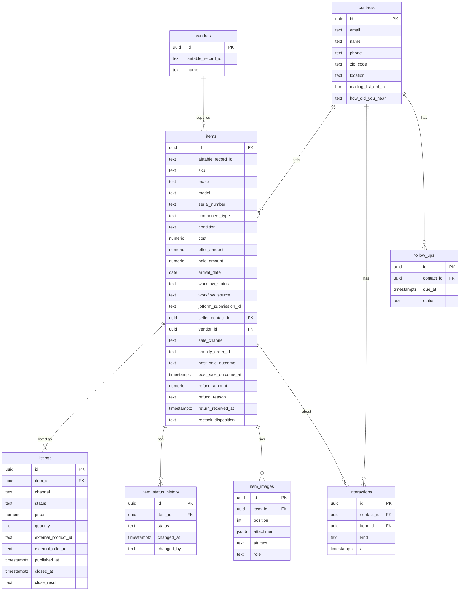

# AWS Postgres Database Plan

Status: draft, planning only. No code or AWS changes yet.

## Goal

Add an AWS-hosted Postgres database alongside Airtable, without disconnecting Airtable. Airtable stays the source of truth until a per-table cutover says otherwise. The long-term aim is a foundation for analytics dashboards and a CRM.

## Decisions

| Decision | Choice | Reason |
|---|---|---|
| Database | RDS Postgres, single-AZ `db.t4g.micro`, 7-day automated backups | CRM and analytics need joins, aggregation and flexible filtering. DynamoDB would force a data-model rewrite later. |
| Upgrade path | `t4g.small` first; Aurora only if usage grows well beyond the assumption below | Same Postgres code. Aurora and RDS Proxy are not needed unless usage changes. |
| Assumption | About 3 users total | Replicas, auto-scaling, multi-AZ and RDS Proxy are unnecessary. Revisit sizing if the team or load grows. |
| DynamoDB | Keep only for tokens, config, job state and idempotency keys | Already planned in `aws-lambda-migration-plan.md`. |
| Seam | `ListingStore` interface under the Lambda handlers | Frontend and `/api` contracts stay unchanged. |
| Rollout | Airtable default, then dual-write, shadow-read, per-table cutover | Airtable wiring stays intact during testing. |

## Current state (from code review)

- The browser never calls Airtable directly. Reads and writes go through `aws/src/providers/airtable/` (`client.ts`, `sources.ts`).
- Configured sources: `users`, `user-guide`, `inventory-directory`, `used-gear-workflow`, `approval-ebay`, `approval-shopify`, `approval-combined`, `shopify-vendors`.
- Server-side filtering is Airtable `filterByFormula` on `Workflow Status`, with subsets `ready-for-publishing`, `listings-page`, `post-publish`.
- There is a 120s in-memory cache and a 200-record cap on the listings page.
- Sorting and most extra filtering happen in the frontend.
- Records are `{id, fields, createdTime}` with human-labelled fields, string-typed values, and single-value arrays.

## Environment strategy

Airtable keeps working in `prod` and `staging` throughout. Only a dedicated test stack uses Postgres.

| Stage | `DATA_BACKEND` | Purpose |
|---|---|---|
| `prod` | `airtable` | Untouched. |
| `staging` | `airtable` | Stable test environment for normal code changes. |
| `pg-test` (new stage, copy of staging, or `dev`) | `dual`, then `postgres` | Only place the new database is exercised. Own RDS instance and stack. |

Rules:

- Stages are separate CloudFormation stacks (see `aws/samconfig.toml.example`). The flag and the RDS instance are per stack.
- An unset `DATA_BACKEND` means `airtable`, so stacks that don't opt in behave exactly as today.
- Merge the seam and Postgres store to `main` early, behind the flag. They are inert until enabled. Avoid a long-lived migration branch.
- Normal feature work continues on `main`. Backend-specific differences go behind the flag, not a fork.
- Shared contract tests run against both implementations, so Airtable changes that are not reflected in Postgres fail visibly.
- Postgres schema changes are versioned SQL migrations. The JSONB mirror absorbs new Airtable fields automatically.
- The `pg-test` stack uses the staging (test) Airtable base and its own secrets, never live production data.
  - Phase 0 finding: there is one production base, `apprsAm2FOohEmL2u`. A test copy (duplicated with records) now exists: `appKOs3hF99ZGBKK3`. `pg-test` must only ever point at this copy.
  - The duplicate has new table and view IDs, so `pg-test` must override every `AIRTABLE_*_TABLE_REF` / `_NAME` value. The code defaults hard-code production IDs (`sources.ts`).
  - Before use: confirm record counts match production and that automations in the copy are turned off.
  - Backups: Airtable base snapshot, the duplicate, and a local read-only JSON snapshot (`scripts/phase0-airtable-snapshot.mjs`, output in gitignored `backups/`).
- Rollback is setting the flag back to `airtable`.
- Backfill is one-way (Airtable to Postgres) until a later decision says otherwise.
- Use short-lived branches only for risky pieces (Postgres store, backfill), merged when tests pass.
- The frontend needs no change. An optional second CloudFront site can point at the `pg-test` API.

## Data model: two layers

### Layer 1: migration mirror (now)

One generic table per environment:

- `records(source text, record_id text, fields jsonb, created_time timestamptz, updated_at timestamptz, airtable_synced_at timestamptz, primary key (source, record_id))`
- Indexed or generated columns for hot fields only: `workflow_status`, `updated_at`.
- No redesign during migration, so diffs between Airtable and Postgres stay meaningful.

### Layer 2: normalized model (grow into it)

Populate from the mirror through a mapper, then move dashboards and CRM features onto it first.

| Today | Normalized |
|---|---|
| Seller fields repeated per workflow record | `contacts` (name, email, phone, zip, opt-in, source) |
| Item data spread across intake and approval tables | `items` (make, model, serial, condition, cost, acquired date) |
| Per-channel approval tables | `listings` (item_id, channel, status, price, external id, timestamps) |
| `Workflow Status` plus `... At` fields | `item_status_history` (item_id, status, changed_at, by) |
| String costs and dates | `numeric` and `timestamptz` |
| Single-item arrays | Scalars |
| New CRM | `interactions`, `inquiries`, `follow_ups` referencing `contacts` and `items` |

Highest-value change: `item_status_history`, which gives cycle-time and aging analytics directly.

## Risks and cautions

- Airtable field names are the current contract. The normalized layer needs an explicit mapping layer.
- Do not normalize before Phase 0 shows which fields are stable.
- Contact de-duplication needs explicit rules (for example, merge by email).
- Dual-write must never fail a request because the mirror failed.
- RDS adds a VPC, security groups and Lambda connectivity (small connection pools; RDS Proxy not needed at ~3 users). Local no-Docker flow needs a local Postgres.
- Cost: roughly $12 to $15 per month, always on. Keep encryption, private subnets and backups on regardless of team size.
- Airtable-specific types (linked records, formulas, rollups, attachments) have no Postgres equivalent. Decide per field: raw JSON or resolved.

## Checklist

Work one phase at a time. Do not start a phase until the previous one is signed off.

### Phase 0: Discovery (no code changes)

Status: complete, signed off 2026-10-21.

- [x] Confirm a separate Airtable test base exists for the `pg-test` stack so dual-write never touches live production data; record the answer in the Environment strategy section. If none exists, decide how to create one before Phase 5.
- [x] Get approximate record counts per source (from the owner's knowledge or a read-only Airtable API call; no writes).
- [x] List every source and its Airtable table, view and approximate record count.
- [x] Capture every field per source, with type, whether used, and which code reads or writes it.
- [x] Document read patterns: filters, sorts, search fields, subsets, max records.
- [x] Document write patterns: create, update, delete, attachment upload.
- [x] Identify linked-record, formula and attachment fields and decide handling.
- [x] Choose the first table to migrate (low risk, not live listings).
- [x] Decide attachment and image handling (keep Drive, Airtable and S3 as they are).
- [x] Draft the normalized schema (ER diagram) and review it.
- [x] Set a monthly budget and pick the dev/staging AWS account and region.

#### Phase 0 findings: sources (snapshot 2026-10-22, base `apprsAm2FOohEmL2u`)

There are nine configured sources (the plan's list of eight omitted `workflow-image-roles`). Source `inventory-directory` has no branch of its own and falls through to the Listings table.

| Source | Table | Table ID | Records |
|---|---|---|---|
| `approval-combined`, `used-gear-workflow`, `inventory-directory` | Listings (shared) | `tbl0K0nFQL64jQMx8` | 3,471 |
| `shopify-vendors` | Vendors | `tblF0B5TUhy20hJCv` | 646 |
| `user-guide` | User Guide | `tblquB9pdwSRXsI7c` | 65 |
| `workflow-image-roles` | Image Roles | `tblkoqoSKypAaZRZe` | 47 |
| `users` | Users | `tblj2Gt9USORo6Vi5` | 18 |
| `approval-shopify` | Shopify Listing | `tblqh6yC0p74UrHZo` | 3 |
| `approval-ebay` | Ebay Listing | `tbl3yTb0JkzUMFNnS` | 2 |
| none | Table 1 | `tblgA8olAJtkRNZvK` | 411 |
| none | Imported table | `tblYqqs0xvnSveIK0` | 0 |

Notes:

- Three sources share the Listings table, so the mirror key should be the physical table plus record ID, not just `source`.
- Field types: no linked-record, formula, rollup or lookup fields. Attachments are `Listings.Images`, `Image Roles.Attachments` and `Table 1.Images`. Read-only computed fields are two `lastModifiedTime` fields on Listings and one `aiText` field on Image Roles.

#### Phase 0 findings: fields

Full per-table inventory (name, type, code references): [airtable-field-inventory.md](./airtable-field-inventory.md). Generated from the read-only schema snapshot, so it contains no record data.

- Listings: 163 fields, 144 referenced by literal name in code. Unreferenced: template, eBay shipping and handling options, Shopify variant option fields, `Pick Up #`, `Submission Group ID`.
- Other tables: Users 9 of 9, User Guide 40 of 49, Vendors 1 of 1, Image Roles 2 of 6 (the role fields and `Attachments` are not referenced by literal name).
- `Imported table` has 494 text fields and 0 records, and is not used by any source. Exclude it from the mirror.
- References are by literal name only. The inventory does not distinguish reads from writes, and price and status variants resolved at runtime may show as unreferenced.

#### Phase 0 decisions: special field types and attachments

- No linked-record, formula, rollup or lookup fields exist, so there is nothing to resolve.
- Attachment fields (`Listings.Images`, `Image Roles.Attachments`, `Table 1.Images`): store the raw Airtable attachment JSON unchanged in the JSONB mirror. No files are copied and nothing changes in the Google Drive archive or the existing image flow. Airtable attachment URLs expire, so mirrored URLs are not durable while Airtable remains the source of truth. Durable storage (for example S3) stays a Phase 9 decision.
- Read-only computed fields (`lastModifiedTime` on Listings, `aiText` on Image Roles): store the value as read, never write it back to Airtable.

#### Phase 0 decision: first table

First table to migrate: **Vendors** (`shopify-vendors`, `tblF0B5TUhy20hJCv`). 646 records, one `singleLineText` field, no attachments, not live listings and not auth. Next candidates: User Guide (65 records), then Image Roles (47 records, has an attachment field). Avoid Users (tied to login) and Listings (3,471 records, 163 fields, live) until the pattern is proven.

#### Phase 0 decisions: budget, account and region

- Monthly budget for the Postgres work: **$25**, against an estimate of about $12 to $15 for single-AZ `db.t4g.micro` plus storage, backups and Secrets Manager. Add an AWS Budgets alert at about 80% in Phase 1.
- Account: the same AWS account as the existing stacks. Keep `pg-test` isolated through its own stack, secrets, RDS instance and the test Airtable base copy (`appKOs3hF99ZGBKK3`).
- Region: `us-east-1`, matching the existing dev, staging and prod stacks.

#### Phase 0 draft: normalized schema (for review)

Derived from the Listings field inventory. Each Listings row is one workflow record for one item, so Listings is split by concern. The mirror stays the source for the mapper. Nothing here is built before Phase 8.

Mapping from Listings fields:

| Target | Source fields |
|---|---|
| `contacts` | `Seller Email`, `Seller Phone`, `Seller Zip Code`, `Seller Location`, `How Did You Hear`, `Mailing List Opt In`. There is no seller name field, so de-duplicate by email. |
| `items` | `Make`, `Model`, `Serial Number`, `Component Type`, `Condition`, `Cost`, `Offer Amount`, `Paid Amount`, `Arrival Date`, `SKU`, `Workflow Status`, `Workflow Source`, `JotForm Submission ID`, `Vendor`, notes and inclusion fields |
| `listings` (one row per channel) | eBay: `Ebay Price`, `eBay Offer ID`, `eBay Listing ID`, `eBay Published At`, `eBay Closed At`, `eBay Close Result`. Shopify: `Shopify Price`, `Shopify REST Product ID`, `Shopify Inventory Quantity`, `Shopify Closed At`, `Shopify Close Result`. Listing content (titles, HTML bodies, categories, tags, shipping) stays in JSONB until needed. |
| `item_status_history` | `Workflow Status` plus the `... At` and `... Signed At` / `... By` fields: Accepted, Processing Signed, Testing Signed, Photography Signed, Pre-Listing Reviewed, Awaiting Pre-Listing Review At, Approved For Publish At, Listed At, Stale Listing At, Sold Ready To Ship At, Shipped At. History before migration can only be reconstructed from these timestamps. Later changes are recorded as they happen. |
| `item_images` | `Images` attachments (raw JSON), `Images Alt Text`, `Workflow Image Metadata JSON`, Image Roles table |
| `items` (sale columns) | `Shopify Order ID`, `Shopify Order Name`, `Post-Sale Outcome`, `Post-Sale Outcome At`, `Refund Amount`, `Refund Reason`, `Return Received At`, `Restock Disposition` |
| Stays JSONB in the mirror | Template, shipping dimension and fee fields, Shopify taxonomy and SEO fields, sync locks and webhook tracking fields, stale-recovery fields |

Review decisions:

- One Airtable Listings record is one physical item. The same item can be posted to both eBay and Shopify, which is why `listings` has one row per channel.
- Contact de-duplication matches on email only.
- `item_images` is a separate table (one item has many images). Sale and return fields stay as columns on `items`, since a sale is 1:1 with the item. Split them out later if one item can have several sales or returns.
- `Users`, `User Guide` and `Image Roles` stay as simple mirrored tables and are not normalized now.
- Costs and dates are strings or Airtable types today and become `numeric` and `timestamptz` in the normalized layer only.

#### Phase 0 findings: read patterns

Code: `aws/src/providers/airtable/sources.ts`, `handlers/airtable/getConfiguredRecords.ts`, `getConfiguredRecord.ts`, `getListings.ts`.

- **Operations:** list, get by ID, and a summary (`getConfiguredRecordsSummary`, which loads the whole source and counts approved vs pending using `Approved` / `Shopify Approved` / `eBay Approved`).
- **Readable sources:** all nine.
- **Pagination:** the client follows Airtable `offset` until done. There is no server-side sort; sorting happens in the frontend.
- **Options:** `fields` projection, `maxRecords` (1 to 1000), `filterByFormula`, `subset`, `searchQuery` + `searchFields`.
- **Subsets** (all filter on `Workflow Status`):
  - `ready-for-publishing` (`approval-combined` only): `Approved for Publish`.
  - `listings-page` (`approval-combined` only): Awaiting Pre-Listing Review, Approved for Publish, Listed Shopify/eBay, Stale Listing Shopify/eBay. Capped at 200 records.
  - `post-publish` (`used-gear-workflow` only): `USED_GEAR_POST_PUBLISH_STATUSES`, default fields `USED_GEAR_POST_PUBLISH_FIELDS` (`shared/contracts/usedGearPostPublish.ts`).
- **Search:** case-insensitive substring across the given fields, built as `SEARCH("q", LOWER({field}&""))`. Field names are resolved against table metadata (10-minute cache). Postgres equivalent: `ILIKE` over the JSONB fields.
- **Default projection:** approval sources use `DEFAULT_APPROVAL_QUEUE_FIELDS` (title, price, quantity, status and similar fields) unless the request sets `fields`.
- **Caching:** 120 s in-memory cache (`configuredRecordsCache.ts`), invalidated on every write.
- **Resilience:** unknown field names in `fields` are stripped and the call retried (10-minute cache of unknown fields).
- **Reference fallback:** with a `*_TABLE_REF`, candidate base/table/view combinations are tried in order. Single-record reads and writes retry on 401, 403 and 404.
- **Other readers:** auth (`providers/auth/users.ts`, reads `users`), Shopify and eBay preview and publish (`getConfiguredRecord`), Jotform backfill (`used-gear-workflow`), take-down (`used-gear-workflow`).
- **Metadata:** `getConfiguredFieldMetadata` (field schema) is available for `inventory-directory` and `used-gear-workflow` only. Phase 2 replaces it with a field-metadata table.

#### Phase 0 findings: write patterns

- **Create** (`createConfiguredRecord`, optional `typecast`): used by auth and by `upsertConfiguredRecord`.
- **Update** (`updateConfiguredRecord`, optional `typecast`): used by auth (login stamps and user upsert), Shopify publish (writes back the product ID), Jotform backfill, and `upsertConfiguredRecord`. It strips unknown fields and retries. It throws a 422 if a Shopify price field is unknown.
- **Delete** (`deleteConfiguredRecord`): allowed sources are `users`, `inventory-directory`, `used-gear-workflow`, `approval-ebay`, `approval-shopify`, `approval-combined`, `shopify-vendors`. Not allowed for `user-guide` and `workflow-image-roles`.
- **Upsert handler** (`upsertConfiguredRecord.ts`): create and update allowed for all nine sources.
- **Attachment upload** (`uploadConfiguredAttachment`): only `inventory-directory` and `used-gear-workflow`, and only fields `fldMXp0EaUHGglU8M` and `fld1zIzmZEciQECah`. The handler can also archive images to Google Drive.
- **Writes are partial updates by field name.** Every write clears the records cache. The mirror must apply the same partial-update behavior and preserve unknown fields.
- **Not covered:** there is no batch write and no transaction across tables.

### Phase 1: AWS foundation (no app changes)

Status: complete, signed off 2026-10-21. **Done 2026-10-23: the user created the $25/month budget with an alert in the Billing console (not verifiable from the deployer user).** Original follow-up: create an AWS Budgets alert at about 80% of the $25/month budget (Billing console). The pg-test RDS instance has been billing since 2026-10-21.

- [x] Create the `pg-test` stage (samconfig entry and stack) pointing at the staging Airtable base; leave `prod` and `staging` on Airtable.
  - Done: `pg-test` template block added to `aws/samconfig.toml.example` (stack `airtable-shopify-ebay-pg-test`, `us-east-1`).
  - Test base verified (snapshot of `appKOs3hF99ZGBKK3`): same 9 tables, record counts, field IDs, table IDs and view IDs as production. Only the base ID differs, so `pg-test` needs the base ID overridden wherever a reference embeds it.
  - **Safety risk:** `sources.ts` hard-codes the production base `apprsAm2FOohEmL2u` in the default refs for `shopify-vendors` and `workflow-image-roles`. `template.yaml` has no parameter for `AIRTABLE_WORKFLOW_IMAGE_ROLES_TABLE_REF`, so a `pg-test` stack would read and write production for that source. Fix before any `pg-test` deploy: add the parameter and env var to `template.yaml`, and set every `*_TABLE_REF` explicitly to `appKOs3hF99ZGBKK3/<table>/<view>`.
  - Done: `aws/template.yaml` now has `AirtableWorkflowImageRolesTableRef` / `...TableName` parameters (default empty, so existing stacks behave exactly as before) wired to `AIRTABLE_WORKFLOW_IMAGE_ROLES_TABLE_REF` / `_NAME`. `sam validate --lint` passes. Not deployed. Note `AirtableShopifyVendorsTableRef` still defaults to the production base, so `pg-test` must override it too.
  - Done: `[pg-test.*]` section added to the local, gitignored `aws/samconfig.toml` (cloned from staging; backup in `backups/samconfig.toml.pre-pgtest`). It uses base `appKOs3hF99ZGBKK3` everywhere (no production base ID remains), explicit vendors and image-roles refs, `EnablePostgres=true`, the default-VPC ID and two subnets (us-east-1a and 1b), and `confirm_changeset = true`. Live Shopify, eBay, Jotform, Google and AI credentials are blank so `pg-test` cannot touch live services. The staging SSM path keys were dropped.
  - Remaining: replace `AirtableApiKey=REPLACE_WITH_TEST_BASE_READ_WRITE_TOKEN` with a new Airtable token scoped to the test base only. Not deployed.
  - Deployed 2026-10-21: stack `airtable-shopify-ebay-pg-test` is `CREATE_COMPLETE` (61 Lambdas, HTTP API, RDS `db.t4g.micro` Postgres 17.6, public, encrypted, deletion protection on). It took several attempts because the deployer user needed extra permissions; these live in a second IAM policy (`aws/deploy/sam-deployer-postgres-policy.example.json`) because the main policy hit the 6,144 character limit. A failed first create left an orphaned RDS instance that had to be deleted by hand because of deletion protection, so for future changes prefer stack updates over fresh creates.
- [x] Create the RDS Postgres instance in the `pg-test` stack (single-AZ `t4g.micro`, private subnets, encryption, 7-day automated backups). Drafted in `aws/template.yaml`, gated by `EnablePostgres` (default `false`); not deployed. Deviation: public endpoint instead of private subnets (see Lambda access below).
- [x] Store credentials in Secrets Manager. `PostgresSecret` generates a 40-character password; the instance reads it through a dynamic reference.
- [x] Define security groups and Lambda access (VPC config with small connection pools; no RDS Proxy). Decision: the instance has a public endpoint and Lambdas stay outside the VPC. Putting 61 Lambdas in a VPC needs a NAT (about $32/month with a gateway, about $3 to $4 with a NAT instance) for Airtable, Shopify, eBay and Google access, which breaks the $25 budget. Lambdas have no fixed IP, so the security group allows 5432 from anywhere and protection is forced TLS (`rds.force_ssl=1`), a generated password, encryption at rest and deletion protection. Revisit (private subnets plus NAT instance) before any `prod` use or real customer data beyond the test copy. Note the test base is a copy of production data.
- [x] Add the resources to `aws/template.yaml` and update the deployer IAM policy.
  - Done: resources added to `aws/template.yaml` (`PostgresSecret`, `PostgresSecurityGroup`, `PostgresSubnetGroup`, `PostgresParameterGroup`, `PostgresInstance`, outputs), all conditional on `EnablePostgres`. Parameters: `EnablePostgres`, `PostgresVpcId`, `PostgresSubnetIds` (two subnets in different AZs). Postgres 17.6, `postgres17` parameter group; `sam validate --lint` passes but confirm the version is available when deploying.
  - Done: `aws/deploy/sam-deployer-policy.example.json` now has four statements for RDS management (scoped to `airtable-shopify-ebay-*`), RDS describe, Secrets Manager and EC2 security group and subnet access.
  - Done: policy applied in IAM. Verified read-only that `resolutionavnyc` can now call `rds:DescribeDBEngineVersions` and `ec2:DescribeVpcs`.
  - Verified: Postgres 17.5 to 17.11 are available in `us-east-1`, so `17.6` is valid. The account has a default VPC, `vpc-07b7e525a1e7e83a5`, with public subnets in six AZs. Suggested `pg-test` values: `PostgresVpcId=vpc-07b7e525a1e7e83a5`, `PostgresSubnetIds=subnet-052666462438dbf5b,subnet-0fcb2c534d16c8fdc` (us-east-1a and 1b).
- [x] Verify connectivity from a throwaway Lambda and from a local script.
  - Local script: done 2026-10-21. Connected to `appdb` over TLS (PostgreSQL 17.6, `ssl=on`), and a plaintext connection was refused. Password read from Secrets Manager at run time, never printed or stored.
  - Lambda: not tested with a throwaway function. Lambdas run outside the VPC and reach the same public endpoint, so the network path is the same. Still to do in Phase 3: bundle `pg` and grant the Lambda role `secretsmanager:GetSecretValue` on the secret. Confirm it with the first real Lambda that connects.
- [x] Decide on the local dev database (Docker Postgres or the dev instance).
  - Decision: local Docker Postgres 17 (same major as RDS, no cost, no shared state). Docker is not installed on this machine yet, so the compose file is added in Phase 2 alongside the migration tool. `pg-test` RDS is only for deployed-stack testing.

### Phase 2: Schema and migrations

Status: complete, signed off 2026-10-21.

- [x] Choose a migration tool or plain SQL-files runner.
  - Decision: plain numbered SQL files in `aws/db/migrations/` plus a small runner (`aws/src/db/migrator.ts`, `npm run db:migrate` with `DATABASE_URL`). Records applied versions and checksums in `schema_migrations`, takes an advisory lock, runs each file in a transaction, and refuses to run if an applied file was edited. Only new dependency: `pg`.
- [x] Create the `records` mirror table and the hot-field indexes.
  - `0001_records_mirror.sql`: `records(base_id, table_id, record_id)` primary key (physical table, not source), `fields jsonb`, `airtable_created_at`, `synced_at`, soft-delete `deleted_at`. Hot-field indexes on `Workflow Status` and lower-cased `Email`. Text search (`SEARCH` formulas) is not indexed yet; decide in Phase 4 when the Postgres read path exists.
- [x] Create a field-metadata table or equivalent to replace `getTableMetadata`.
  - `0002_airtable_fields.sql`: `airtable_fields(base_id, table_id, field_id, name, type, options jsonb)`, same shape as `getTableMetadata`. Populated by the backfill in Phase 4.
- [x] Apply migrations in dev and verify idempotency.
  - Verified 2026-10-21 on a scratch database on the `pg-test` RDS instance (Docker is not installed): first run applied 0001 and 0002, second run applied none. Scratch database dropped. Applied to the real `appdb` on `pg-test` on 2026-10-21 (0001, 0002); re-run applied none. Unit tests for the runner pass (`npm test`).

### Phase 3: Code seam (Airtable behavior unchanged)

Status: complete, signed off 2026-10-21.

- [x] Extract the `ListingStore` interface from the current Airtable client operations.
  - `aws/src/store/listingStore.ts`: 8 methods (`getRecords`, `getRecordsSummary`, `getRecord`, `createRecord`, `updateRecord`, `deleteRecord`, `getFieldMetadata`, `uploadAttachment`), mirroring the existing `*Configured*` functions. Source-level policy (which sources may delete or upload) stays in the handlers.
- [x] Wrap the existing Airtable implementation behind it.
  - `airtableListingStore` delegates to the unchanged `providers/airtable/sources.ts`. `store/index.ts` re-exports the same function names, so the 12 callers (handlers and `crossChannelClose`) changed only their import path.
- [x] Add the `DATA_BACKEND` flag (`airtable` | `dual` | `postgres`), default `airtable`, settable per source.
  - `DATA_BACKEND` (default `airtable`) plus `DATA_BACKEND_OVERRIDES` (`source=backend,source=backend`) for per-source settings. Template parameters `DataBackend` and `DataBackendOverrides` default to `airtable` / empty. `dual` and `postgres` return HTTP 501 `DATA_BACKEND_NOT_IMPLEMENTED` until Phase 4/6, and invalid values return 500, so a typo never silently falls back.
- [x] Add shared contract tests that any implementation must pass.
  - `store/listingStore.contract.ts` (`runListingStoreContract`) covers create/get, update merge, delete, `maxRecords` and field projection, summary, field metadata and the attachment allow-list. The Airtable store runs it against an in-memory fake of the Airtable client. Filter and search semantics are not in the contract yet because they need the Postgres implementation to compare against (Phase 4).
- [x] Confirm existing tests and local `/api` validation still pass.
  - `aws` typecheck and `npm test` pass (17 tests). The full root AWS suite (`tests/unit/aws`, 438 tests) passes before and after the change. `npm run local:api:check` is OK. Note: `npm run test:aws` only runs 5 tests because its unquoted `**` glob is not recursive in `sh`; run `node --import tsx --import ./tests/unit/aws/network-guard.ts --test $(find tests/unit/aws -name '*.test.ts')` for the full suite.

### Phase 4: Postgres implementation and backfill

Status: complete, signed off 2026-10-21.

- [x] Implement the Postgres `ListingStore` (list, get, create, update, delete, subsets, search).
  - `aws/src/store/postgresListingStore.ts` (`createPostgresListingStore`), not yet wired into `getListingStore` (that is Phase 5/6, so behavior is unchanged). Reads the `records` mirror keyed by physical base and table, resolved through the new `resolveConfiguredSourceTable` in `sources.ts`. Subsets share their status lists with the Airtable code (`resolveSubsetStatuses`).
  - Differences from Airtable to keep in mind: no `filterByFormula` beyond the three auth equality shapes (`{F} = "x"`, `LOWER({F}) = "x"`), anything else is HTTP 400; search is a case-insensitive substring over the requested fields on the raw JSON value (arrays and objects are matched as JSON text, no index yet); results are ordered by creation time then id, not Airtable view order; delete is a soft delete; writing `null` removes a field; created ids are `rec` plus 14 random characters; attachment upload returns HTTP 501 until a storage decision is made.
- [x] Run the contract tests against Postgres.
  - `postgresListingStore.test.ts` runs the shared contract plus subset, search, auth-formula, null-clear and soft-delete cases. It needs `POSTGRES_TEST_URL` (a scratch Postgres) and is skipped otherwise. 11 of 11 passed on a scratch database on `pg-test` (dropped afterward). The contract has a new `attachments: 'not-implemented'` mode for backends that cannot store attachments yet.
- [x] Write an idempotent Airtable-to-Postgres backfill script with row-count reporting.
  - `aws/src/db/backfill.ts` and `backfill-cli.ts` (`npm run db:backfill -- --base appKOs3hF99ZGBKK3 [--tables ...] [--apply]`). Default is a dry run (Airtable GET only, counts only). `--apply` upserts `records` and `airtable_fields` in one transaction per table, soft-deletes rows missing from a full read, and reports Airtable vs Postgres counts. Refuses the production base without `--allow-production-read`. Verified 2026-10-21: dry run on the test base matched the Phase 0 counts; `--apply` on a scratch database on `pg-test` loaded 4,252 records and 294 fields with counts matching Airtable per table, and a second run was idempotent (0 inserted, all updated). Scratch database dropped.
- [x] Backfill dev data and diff counts and fields.
  - 2026-10-21: backfilled the test base (`appKOs3hF99ZGBKK3`) into `appdb` on `pg-test`: 4,252 records across 7 tables. Counts match Airtable per table, and a deep comparison of every record's fields found 0 differences.

### Phase 5: Shadow write

Status: signed off 2026-10-22.

- [x] Enable `dual` for the first table.
  - 2026-10-21: `pg-test` stack updated (`UPDATE_COMPLETE`, 61 functions and the API modified, none replaced) with `DataBackend=airtable` and `DataBackendOverrides=shopify-vendors=dual`. `pg-test` points only at the Airtable test base. The shopify-vendors reference there was checked to use the test base, not production.
- [x] Mirror writes to Postgres after Airtable succeeds; log and meter mirror failures without failing requests.
  - Code written and tested locally, not deployed. `store/dualListingStore.ts` reads from Airtable only; create, update, delete and attachment upload write to Airtable first, then mirror Airtable's returned record into `records` through `store/postgresMirror.ts` (same ids and fields). A mirror failure is logged as `postgres_mirror_failed` plus a CloudWatch EMF metric `AirtableShopifyEbay/DataBackend` `PostgresMirrorFailure` (dimensions Source, Operation), and never fails the request. An Airtable failure skips the mirror. `getListingStore` returns it for `dual`; `postgres` is still 501.
  - `template.yaml` Globals now sets `DATABASE_URL` (only when `EnablePostgres` is true, otherwise empty) from the Secrets Manager password and RDS endpoint. Note this puts the DB password in the Lambda environment configuration, the same way the Airtable and Shopify secrets are passed today. `db/pool.ts` uses 3 s connect and 5 s query timeouts so a slow database cannot stall a request.
  - Tests: 5 unit tests with fakes, plus a gated Postgres mirror test. All 34 `aws` tests pass against a scratch database; the root suite still passes 438.
- [x] Run the write-validation workflow in `aws-lambda-write-validation.md`.
  - The documented probe targets the local API and does not cover `shopify-vendors`, and deployed routes need a logged-in session. Instead I ran the same store code locally against the Airtable test base and the `pg-test` database (`DATA_BACKEND_OVERRIDES=shopify-vendors=dual`): create, update and delete of one temporary `PG-DUAL-PROBE-*` Vendors row. After each step the Postgres row matched Airtable's record exactly, and delete removed it from Airtable and soft-deleted it in Postgres. The temporary Airtable row is gone (Vendors is back to 646); one soft-deleted row remains in `appdb` and is reconciled by the next backfill. Still to do: exercise `dual` through the deployed API with a real login (for example editing a vendor in the deployed `pg-test` UI).
- [x] Review failure logs and fix gaps.
  - Done 2026-10-22. A vendor created through the deployed `pg-test` API (approval form Vendor field) landed in Airtable and was mirrored to `records` within about a second. No `postgres_mirror_failed` entries in the create function logs. The test vendor was then deleted from the Airtable test base and soft-deleted in Postgres.
  - Found while testing: against the full-size test base, `used-gear-workflow` (no row cap) and `approval-combined` reads return HTTP 500 because the Lambda response exceeds the 6 MB limit. These are Airtable-only reads, unrelated to `dual`. Not yet checked whether staging or production hit the same limit. Look at this separately before any read cutover.

### Phase 6: Shadow read

Status: signed off 2026-10-22. Deployed to `pg-test`.

- [x] Read from both backends, serve Airtable, and log mismatches.
  - Code done 2026-10-22 (`aws/src/store/shadowRead.ts`, `dualListingStore.ts`, wired in `index.ts`). In `dual` mode, `getRecords` and `getRecord` return Airtable's answer, then read Postgres (3 s timeout, awaited because Lambda freezes unfinished work) and compare by record id, ignoring order and null fields. Capped reads (`maxRecords`) compare only the count and shared rows. Logs `postgres_shadow_read` (field names only, never values) plus EMF metrics `ShadowReadMismatch`, `ShadowReadError`, `AirtableReadMs`, `PostgresReadMs` by Source and Operation. Outcomes: match, mismatch, unsupported (formula Postgres can't run), timeout, error. 4 new tests; `aws` suite passes. Deployed to `pg-test` 2026-10-22 (13 resources modified, none replaced). First real reads through the deployed API (`shopify-vendors`, `getRecords`): both matched exactly, 646 vs 646 records, zero field differences. Latency: Airtable about 1.16 to 1.19 s, Postgres about 0.28 to 0.31 s (includes a cold connection).
- [x] Fix drift until diffs are zero for an agreed period.
  - Agreed period (2026-10-22): short, a few manual checks on the test stack only. Revisit with a longer window when staging or prod runs `dual`. Local read-only checks against the test base and `pg-test` Postgres (vendors): full list 646/646, three single-record reads, `maxRecords=10`, a search (95/95) and a field-projected read all matched with zero field differences.
- [x] Measure latency of both paths.
  - Deployed Lambda, vendors full list: Airtable about 1.2 s vs Postgres about 0.3 s. Local single-record reads: about 140 ms vs 63 ms. Metrics `AirtableReadMs` and `PostgresReadMs` are emitted per read for later comparison. Shadow reads add the Postgres time to each dual read, so they should be removed or sampled once Phase 7 starts.

### Phase 7: Per-table cutover

Status: closed 2026-10-23. Cut over: `shopify-vendors`, `user-guide`. Reverse sync deferred (only needed once writes move to Postgres). Follow-ups, each blocked as noted below: `users`, `workflow-image-roles`, listing tables.

- [x] Switch reads to Postgres for one table; keep Airtable writes in place.
  - Code and tests done 2026-10-22: new backend value `postgres-read` (`aws/src/store/postgresReadListingStore.ts`). Reads (`getRecords`, `getRecord`, `getRecordsSummary`) come from Postgres. Writes and attachments still go Airtable-first and are mirrored to Postgres (the `dual` write path), and field metadata stays on Airtable. If a Postgres read fails for any reason (unsupported formula, missing row, database down), it falls back to Airtable and logs `postgres_read_fallback` plus metric `PostgresReadFallback`. `postgres` stays 501 until writes move. 3 new tests; `aws` suite passes (29 passed, 1 skipped). Deployed to `pg-test` 2026-10-22 (62 resources modified, none replaced; `DataBackendOverrides=shopify-vendors=postgres-read`). A logged-in vendor list read through the deployed API returned 646 vendors with no `postgres_read_fallback` entries and no shadow-read lines (so the Postgres path served it).
- [x] Confirm rollback is a single flag change and test it.
  - Tested 2026-10-22 on `pg-test`: changing only `DataBackendOverrides` from `shopify-vendors=postgres-read` to `shopify-vendors=dual` and deploying (62 functions and API modified, none replaced) returned `UPDATE_COMPLETE`, and the deployed reads Lambda's `DATA_BACKEND_OVERRIDES` reads `shopify-vendors=dual`. Rollback to Airtable-only reads is the same change with `airtable`. Redeploy takes a few minutes. `pg-test` was then put back on `postgres-read` for vendors (2026-10-22, same change-set process).
- [x] Consider reverse sync until confident. Deferred: Airtable stays the write source, so the mirror never diverges from it.
- [x] Repeat per table (safe tables done; the rest are named follow-ups below).
  - `user-guide` done on `pg-test` 2026-10-23: `dual` first (4 shadow reads, 65 of 65 records, zero differences; Postgres about 21 ms warm vs Airtable 0.5 to 1.8 s), then `postgres-read` (three reads after cutover returned 65 records, no fallbacks, no shadow lines). Current `pg-test` setting: `shopify-vendors=postgres-read,user-guide=postgres-read`.
  - `workflow-image-roles` parked: its `Attachments` field stores Airtable file URLs that expire, so Postgres reads would serve stale links. Needs a refresh-on-read or durable storage (Phase 9 question) first.
  - 6 MB response limit (investigated 2026-10-23): the Listings table is about 14.6 MB of JSON in the test base (3,471 records). `Workflow Image Metadata JSON` is 7.9 MB and `Images` 3.7 MB of that (about 80%). The failing reads return every field with no row cap (`ready-for-publishing`, `used-gear-workflow`). The test base is a copy of production, so staging and production probably hit the same limit (not verified). Fix 1 (deployed to `pg-test` and verified 2026-10-23: the Listings page loads through API Gateway): `getConfiguredRecords` gzips responses of 256 KB or more when the client sends `Accept-Encoding: gzip` (`aws/src/shared/http.ts`; the local API server decodes base64 bodies). Roughly 14.6 MB becomes about 1.5 MB. Fix 2 for later: drop the heavy fields from list reads and fetch them on the detail view. Audit 2026-10-23 (read-only, no code changed): the web client already passes `fields` or a `maxRecords` cap on every list read found (approval queue `APPROVAL_QUEUE_FIELDS` + `listings-page` cap, ready count `READY_COUNT_FIELDS`, all 9 `usedGearQueue` calls, search capped by `COMBINED_QUEUE_MAX_FETCH_LIMIT`), so a client-side Fix 2 has little left to remove. A server-side strip of `Workflow Image Metadata JSON` or `Images` would change the `/api` contract (approval prefill, image helpers and the editor read them), so it is NOT planned. Gzip (Fix 1) plus these caps is the answer for now.
  - Follow-ups (not part of Phase 7 sign-off):
    - Login timing measured 2026-10-23 (read-only): the login Lambda's own durations in CloudWatch were 414 ms warm, 1.54 s on a cold start, and one 10.5 s outlier on 2026-10-22 (3 samples only). A login does one Airtable lookup (about 110 to 380 ms from a laptop) plus a PBKDF2 check (210,000 iterations; 24 ms locally, likely a few hundred ms on the 256 MB Lambda). Moving the lookup to Postgres would save roughly 0.1 to 0.4 s, so login is not the main wait; the data loads after login (listing reads still on Airtable) are likely larger.
    - `users`: login source. Postgres supports only the three auth exact-match formulas, so shadow-read in `dual` first and check logins before `postgres-read`.
    - `workflow-image-roles`: needs refresh-on-read or durable attachment storage (Phase 9).
    - Listing tables: need general `filterByFormula` support in the Postgres store and Fix 2 (drop heavy fields from list reads). Survey 2026-10-23: the server only sends the three auth equality formulas today (listing reads use `subset`, which Postgres already supports), so general `filterByFormula` is probably not needed; confirm before building it.
    - Mirror freshness (read-only check 2026-10-23): `pg-test` runs `DataBackend=airtable` with overrides for only vendors, user-guide and users, so listing writes are not mirrored. Every `records` table was last synced 2026-10-22 05:09 UTC (the backfill), including Listings (3,471 rows), so the Listings mirror and the normalized tables built from it are stale and drift with every Airtable edit. Before any listing cutover or dashboard use: put the listing sources on `dual` (or re-run backfill, then `db:normalize`). Done 2026-10-23 with approval: `pg-test` overrides now also have `used-gear-workflow`, `approval-ebay`, `approval-shopify`, `approval-combined`, `inventory-directory` = `dual` (change set: 62 Lambdas and the API modified, none replaced; `UPDATE_COMPLETE`). Airtable still serves every read. Catch-up run 2026-10-23 with approval: `db:backfill --apply` (all 7 tables, counts equal Airtable, 0 inserted, 0 deleted, rows rewritten) then `db:normalize --apply` (3,471 items, 785 contacts, 43 listings, 655 history, 3,760 images, same as before). The batched mapper took about 21 s on RDS from a laptop, down from about 17 minutes. First check 2026-10-23 (read-only, after the user browsed Listings, approval and Inventory and saved one description edit on `recaLF4Ib84WTsVaD`): 69 shadow reads, all `match`, zero mismatches, errors, timeouts or fallbacks (`used-gear-workflow` 44 list + 8 single, `approval-combined` 5 list + 7 single, `users` 5). The edit reached the mirror (`records.synced_at` for that row moved to the time of the save). Latency: Postgres list reads averaged about 1.7 s (max 3.2 s, near the 3 s shadow cap) against about 4.5 s for Airtable; single-record reads 234 ms vs 372 ms. List reads are slow in Postgres because they return the full 14 MB-class rows, so a `postgres-read` cutover for listings needs the heavy-field cost looked at first. Measured 2026-10-23 (read-only, RDS from a laptop, 3 runs): Listings table query execution is about 2 ms; the time is transfer. All fields 15.0 MB, 12.6 to 13.0 s over the internet; minus the two heavy fields 2.9 MB, about 2.6 s; three fields 0.1 MB, about 0.2 s. Stored size: `Workflow Image Metadata JSON` 7.5 MB and `Images` 4.0 MB of 7.7 MB compressed. So the heavy fields are the cost. Fix (local, not deployed, no contract change): `postgresListingStore.getRecords` now projects the requested `fields` in SQL (`jsonb_each` filter) instead of fetching full rows and filtering in JS; reads with no `fields` are unchanged. New test; `aws` suite 60 passed. Deployed to `pg-test` 2026-10-23 with approval (change set: 30 Lambdas and the API modified, none replaced; `UPDATE_COMPLETE`; config unchanged). Verified 2026-10-23 after the user browsed Listings: 23 list shadow reads (19 `used-gear-workflow`, 3 `approval-combined`, 1 `users`), all `match`, no errors, timeouts or fallbacks. Postgres list reads averaged 539 ms (max 2.5 s) against 5.7 s for Airtable in the same requests, down from about 1.7 s before the projection fix.
  - Pre-cutover comparison 2026-10-23 (read-only, Airtable API vs the `records` mirror, test base): `shopify-vendors`-style tables `tblj2Gt9USORo6Vi5` (18) and `tblquB9pdwSRXsI7c` (65) match exactly (0 missing, 0 field diffs). `tblkoqoSKypAaZRZe` (`workflow-image-roles`, 47) differs on `Attachment Summary` in every row (expiring attachment URLs), as already parked. FINDING: `inventory-directory` resolves to table `tblgA8olAJtkRNZvK`, which was never backfilled (no rows in `records`; the mirror has only 7 tables). `postgres-read` on it would return an empty list rather than an error, so no fallback. It is now on `dual`, so new writes to it would create partial mirror rows and its shadow reads will show mismatches. Do NOT cut over `inventory-directory` until it is backfilled; consider removing it from `dual` meanwhile. Next candidate with shadow evidence: `used-gear-workflow` (19 list and 8 single matches) or `approval-combined`. Executed 2026-10-23 with approval (change set: 62 Lambdas and the API modified, none replaced; `UPDATE_COMPLETE`): `approval-combined` is now `postgres-read` (Airtable fallback on error), and `inventory-directory` was removed from `dual` (back to `airtable`). Current `pg-test` overrides: `shopify-vendors=postgres-read,user-guide=postgres-read,users=dual,used-gear-workflow=dual,approval-ebay=dual,approval-shopify=dual,approval-combined=postgres-read`. Rollback: set `approval-combined=dual` and deploy. Check 2026-10-23 after the user browsed Listings and approval (10 minutes of traffic): zero `postgres_read_fallback` lines in any Lambda; `used-gear-workflow` (still `dual`) logged 19 more shadow list reads, all `match` (Postgres about 130 ms to 2.5 s, mostly 200 to 550 ms, vs Airtable 1.7 to 8 s). Caveat: `postgres-read` emits no success log, so I cannot positively confirm that `approval-combined` reads were served from Postgres; only that none fell back and the pages loaded. Let it run for a few days before the next cutover. Note: the physical Lambda log groups use the shorter prefix `airtable-shopify-ebay-pg--...` (not `...-pg-test-...`).

### Phase 8: Normalized layer and CRM foundations

**Status: closed 2026-10-23, signed off by the user.**

- [x] Build the mapper from the mirror to normalized tables (`contacts`, `items`, `listings`, `item_status_history`).
  - Done locally 2026-10-23, nothing deployed or applied to RDS. Migration `aws/db/migrations/0003_normalized_layer.sql` (`contacts`, `items`, `listings`, `item_status_history`, `item_images`). Pure mapper `aws/src/db/normalize.ts` and idempotent applier `aws/src/db/normalizeApply.ts` read only from the `records` mirror and write only to the normalized tables. 7 unit tests plus 1 integration test against a scratch Postgres.
  - Run against the 2026-10-22 test-base snapshot in a local Postgres 18 (3,471 Listings): 3,471 items, 790 contacts (785 after the phone rule below), 43 listings (5 eBay published/closed, 17 eBay draft, 21 Shopify; see counts below), 655 history rows, 3,760 images. Checks: workflow status matches the mirror for every item, image count equals the mirror, every record with an email links to a contact (984), distinct emails equal contacts before the phone rule (790), re-running changes nothing.
  - Findings: 2,487 of 3,471 records have no seller email (no contact, item still created). Seven emails appear with different phone numbers; the newest record's value wins. `Vendor` is a text name, not a link, so `items.vendor` holds the text. `SKU` arrives as `{text}` and is unwrapped. `Images Alt Text` has no data in the test base, so `item_images.alt_text` and `role` stay null for now. `item_status_history` has one row per milestone (no row for the current status when no timestamp exists). `vendors` is not normalized yet.
  - CLI added: `npm run db:normalize -- --base <appId> [--apply]` (`aws/src/db/normalize-cli.ts`). Default is a dry run that only reads the mirror. Dry run against the live `pg-test` mirror (read-only, 2026-10-23) gave 3,471 items, 785 contacts, 43 listings, 655 history rows, 3,760 images, the same as the local run.
  - Applied to `pg-test` RDS 2026-10-23 with approval: migration 0003, then `db:normalize --apply`. Result: 3,471 items, 785 contacts, 43 listings, 655 history rows, 3,760 images; workflow status matches the mirror for every item, no open transactions left. Only new tables were written (no change to `records`, Lambdas or Airtable). Run time was about 17 minutes from a laptop because the applier issues one query per row; batch the inserts before running it from a Lambda or on a schedule. Batched afterwards (400 rows per statement, one transaction): local real-data run took 329 ms with identical counts and 0 status mismatches; not yet re-run on RDS. A second run on RDS was not repeated (idempotency is covered by the local test and the local real-data rerun).
  - Not yet decided: when the mapper runs in production use (after each backfill, or per write). For now it is a manual, rebuildable step.
- [x] Define and test contact de-duplication rules.
  - Done locally 2026-10-23 (`mergeContacts` in `aws/src/db/normalizeApply.ts`, `phoneKey` in `normalize.ts`, `alternate_emails` column in migration 0003). Rules: (1) same lower-cased, trimmed email is one contact. (2) A new email also merges into an existing contact when it shares a 10-digit phone (formatting and a leading 1 ignored) AND looks like the same address: identical local part, or within two edits. (3) Phones under 10 digits never match. A phone shared by unrelated emails (a household) never merges. The primary email is the most frequent one (newest on ties) and the others are kept in `alternate_emails`, so no address is lost. The newest non-empty phone, zip, location and source win; mailing-list opt-in is sticky.
  - Data check: none of the 2,487 records without an email has a phone or any seller field, so phone matching cannot recover contacts for them (they are inventory-style rows with no seller). Phone matching only caught the typo and alias pairs. On the snapshot it merged exactly 5 pairs (790 to 785 contacts): wmkig/wmkug@comcast.net, plerner07@aol/gmail, jonnytheweb@hotmai/hotmail.com, tomhreilly@sbcglobal.net/.ny, ming1958127@gimal/gmail.com. 4 new unit tests; `aws` suite 54 passed against a scratch Postgres.
- [x] Move the first dashboard onto normalized tables.
  - Code and tests done locally 2026-10-23, not deployed. First dashboard piece: a read-only "Sellers" card (user choice). New additive endpoint `GET /api/dashboard/sellers-summary` (`aws/src/handlers/dashboard/getSellersSummary.ts`, query in `aws/src/db/sellersSummary.ts`) reads `contacts` and `items` only. It is admin-only (full-access roles) because it returns seller emails; returns 503 `POSTGRES_NOT_CONFIGURED` when `DATABASE_URL` is unset. New Lambda and route in `aws/template.yaml` and the local API server. Frontend: `DashboardSellersSection` (shown to full-access roles, hidden if the call fails; developers see a warning), `dashboardAppApi.getSellersSummary`. No existing contract changed. Tests: web 1,178 passed, root aws 439 passed, aws 56 passed with a scratch Postgres.
  - Deployed to `pg-test` 2026-10-23 with approval (change set: 3 added, 50 modified, none replaced; `UPDATE_COMPLETE`). Verified in the UI by the user: 785 sellers, 785 with items, 112 repeat sellers, 95 on the mailing list, top-10 table. Unauthenticated calls return 401.
  - Known gaps: "Last arrival" shows a dash for every seller because seller intake rows have no `Arrival Date` (fixed locally, not deployed: falls back to `airtable_created_at`). "With items" equals "Sellers" because contacts are built only from item rows.
  - Login is not on Postgres: `providers/auth/users.ts` reads the Users table straight from Airtable (it bypasses the store seam), plus a PBKDF2 hash check. Moving login reads is the `users` follow-up from Phase 7.
- [x] Add CRM tables (`interactions`, `inquiries`, `follow_ups`).
  - Migration written and tested locally 2026-10-23 (`aws/db/migrations/0004_crm_tables.sql`, 3 tests, `aws` suite 59 passed). Design: `interactions` (contact, optional item, kind email/call/text/visit/note/other, summary), `inquiries` (optional contact since the sender may be unknown, channel, subject, message, status open/answered/closed), `follow_ups` (contact, optional item, due date, status open/done/cancelled). CHECK constraints stop a resolved/completed timestamp on an open record. These hold human-entered data that exists only in Postgres, so contacts are `ON DELETE RESTRICT` (a contact with history cannot be deleted) and a removed item only clears the reference. Schema only: no API or UI yet.
  - Applied to `pg-test` RDS 2026-10-23 with approval: the three tables exist and are empty; items (3,471), contacts (785) and the mirror (4,252) are unchanged.

### Phase 9: Later decisions (not now)

- [x] Attachments and images storage.
  - Decision 2026-10-23 (user): for now keep the files in Google Drive and the existing image flow. No S3 copy, no change to attachments. Consequences: `workflow-image-roles` and the listing tables stay on Airtable (or `dual`) until URL refresh-on-read or durable storage is chosen; the mirror keeps raw attachment JSON with expiring URLs. Revisit S3 when retiring Airtable. Open: cause of the sign-in-page `original` files and whether production has them.
  - Read-only survey 2026-10-23 of the 2026-10-22 test-base snapshot (no calls made): only one attachment field exists with data, `Listings.Images`: 628 records, 3,760 files, about 1.98 GB total (largest file under 1 MB). Image Roles and Table 1 have none in the snapshot. About half the files (1,877) are typed `text/html` yet have `.jpg` names and ~0.94 MB sizes (1,772 MB of the total); the other 1,883 are `image/jpeg` (206 MB). Checked 2026-10-23 with read-only calls (one record GET, HEAD on 6 URLs, a 300-byte range read of one file; nothing written): the `text/html` files named `...-original--original.jpg` are Google account sign-in pages (a failed Google Drive download saved as an image), not photos. So only the 1,883 `image/jpeg` `...-processed.jpg` files (about 206 MB, 1200x900) are real images. Whether the same happens in production, and who creates these `original` attachments, still needs checking.
  - Options: (a) copy only real images to S3 (about 206 MB, under $0.01 a month), skip or flag the sign-in pages; (b) keep Airtable as the file store and refresh URLs on read; (c) S3 plus fixing the Drive step so originals are real. Recommendation: (a) and find the cause of the bad originals first. Not yet decided: S3 copy vs refresh-on-read vs keep Airtable as the file store.
- [x] Auth and user records. (Closed 2026-10-23 on `pg-test`: steps 1 and 2 done, `users=postgres-read` deployed and verified; step 3, writes on Airtable, is deferred to retirement.)
  - Read-only code survey 2026-10-23 (no calls, no changes). The store seam is wired in handlers (`handlers/airtable/*`, webhooks, publish), but auth does not use it: `providers/auth/users.ts` calls `getConfiguredRecords/createConfiguredRecord/updateConfiguredRecord('users', ...)` in `sources.ts` directly. Reads: `findAuthUserByEmail` (exact match, then a `LOWER({Email})` fallback; per-process cache) and `loadAuthUsers` (full table). Writes: password upgrade on login (`updateAuthUserPassword`), email change (`updateAuthUserEmail`, which bypasses the `authUserDependencies` hook), and user create/update in admin flows with retry on unknown fields. Password hashes (PBKDF2) live in the Airtable Users record.
  - Risks for a move: a failed or stale Postgres read could lock users out, and writes must stay Airtable-first so a password change is never lost. Plan: (1) route auth reads through the store with `dual` shadow reads and compare results only, (2) then `postgres-read` for `users` with Airtable fallback, (3) leave writes on Airtable until Phase 9 retirement. Expected gain is small (login about 0.1 to 0.4 s). Step 1 code done locally 2026-10-23, not deployed: `providers/auth/users.ts` now imports from `store/index.js` (all auth reads and writes, including `updateAuthUserEmail`, go through `authUserDependencies`), so `DATA_BACKEND_OVERRIDES=users=dual` applies. With no override the backend is `airtable`, so behavior is unchanged. Root aws tests 440 expected. Caveat: in `dual`, password-hash updates are also mirrored into the Postgres `records` table (PBKDF2 hashes, same as already mirrored by backfill). Deployed to `pg-test` 2026-10-23 with approval (change set: 62 Lambdas and the API modified, none replaced; `UPDATE_COMPLETE`; `DataBackendOverrides` now also has `users=dual`). First check 2026-10-23: user logged in, login worked; shadow read of `users` outcome `match` (1 record each, no field mismatches; Airtable 1,586 ms cold vs Postgres 799 ms in that sample). One sample only: let it run across a few more logins (and an admin user-list view) before `postgres-read`.
- [ ] Retiring Airtable.
- Read-only check 2026-10-23: instance is `db.t4g.micro`, 20 GB, single-AZ. The deployer user `resolutionavnyc` cannot read Budgets (`budgets:ViewBudget`) or CloudWatch metrics (`cloudwatch:GetMetricStatistics`), so the Budgets alert cannot be created or checked from here and RDS CPU/memory cannot be measured. Options: create the budget in the console (about 80% of $25, email alert), or approve adding Budgets and CloudWatch read permissions to the second policy `airtable-shopify-ebay-postgres-deploy`. Not changed.
- [ ] Instance upgrade (`t4g.small`), and only if usage outgrows the 3-user assumption: Aurora, read replica, or Athena for heavy reporting.

- 2026-10-23: Cut over `approval-ebay`, `approval-shopify` and `inventory-directory` to `postgres-read` on `pg-test` (62 Lambdas and the API modified, none replaced; `UPDATE_COMPLETE`). Evidence: these sources had no UI traffic in 24 h (so no shadow reads), so instead a read-only full compare of Airtable vs the mirror: `tblgA8olAJtkRNZvK` (approval-ebay and inventory-directory) 411 = 411, `tblqh6yC0p74UrHZo` (approval-shopify) 3 = 3, 0 missing, 0 field differences. Fallback to Airtable on any Postgres error. Only `workflow-image-roles` is now on Airtable. Roll back with `=dual`.

- 2026-10-24: Speed audit of `getConfiguredRecords` call sites: all list reads already project fields except four loaders in `usedGearQueue.ts` that fetch `Workflow Image Metadata JSON` (about 7.5 MB) for all 3,471 listings. Fixed the worst, `loadUsedGearOperationalRecordContext` (opened on every record page): sibling rows now skip that field; the selected record is still fetched in full. Same day: also applied to `loadUsedGearOperationalRecordBySku`, `loadParkingLotArrivalQueue` and `loadWorkflowProgressQueue` after checking that none of their consumers (progress section, parking-lot pages, dashboard targets, eBay/Shopify snapshot pages, workflow summary builder) read image metadata; the image editors still load the full record. Web suite 1,180 passed. Remaining: short in-Lambda caching for vendors, user guide and users. Frontend-only change: needs no AWS deploy.

### Phase 10: Staging and production rollout (not started, plan only)

`pg-test` has only ever used the test base. Nothing below has run against production data. Do each step on `staging` first, with approval and a change set, and keep `prod` on Airtable until all of it passes.

- [ ] Staging database: create a separate RDS instance and secret for `staging` (do not reuse `pg-test`), apply migrations 0001 to 0004, and set up the Budgets alert and backups. Decide whether the endpoint stays public (currently 0.0.0.0/0 on 5432 with TLS) or moves to private subnets.
- [ ] Backfill from the staging base with `db:backfill`, then check counts equal Airtable and run `db:normalize` as a dry run first. Check the mapper on staging data (it has only run on the test base) and the contact de-dup results.
- [ ] Confirm staging and prod Lambdas hit the same 6 MB response limit that gzip and field projection fixed on `pg-test`.
- [ ] Start staging at `dual` for all sources, with a longer shadow-read window than `pg-test` (days of real use, zero mismatches and zero fallbacks), then cut over one source at a time in the order used on `pg-test`.
- [ ] Mirror freshness: decide how drift from edits made outside the app is caught (a scheduled re-backfill), since `postgres-read` serves stale rows otherwise. User said 2026-10-23 that Listings are edited only through the app; re-confirm for prod and for Airtable automations.
- [ ] Attachments: `workflow-image-roles` stays on Airtable until expiring URLs are handled (see Phase 9). Find the cause of the Google sign-in `original` files and check whether prod has them.
- [ ] Production: same steps, with a fresh Airtable backup first, `prod` stays `airtable` until staging has run clean, and every source keeps the `dual` then `postgres-read` rollback path. Writes stay Airtable-first until the retirement phase.
- [ ] Reverse sync or a retirement decision: Airtable stays the source of truth for writes until the user decides otherwise.

## Out of scope

- Disconnecting Airtable.
- Changing frontend behavior or `/api` contracts.
- Moving Shopify or eBay integrations.

- 2026-10-23: Backfilled `tblgA8olAJtkRNZvK` (`inventory-directory`) into `pg-test` RDS: 411 Airtable = 411 Postgres, 25 fields. It is still on the Airtable backend and can now be set to `dual` for shadow reads before any cutover. Airtable was only read.
- 2026-10-23: Deployed `inventory-directory=dual` to `pg-test` (62 Lambdas and the API modified, none replaced). Airtable still serves; Postgres is shadow-read only. Next: user opens the inventory directory page, then check `postgres_shadow_read` outcomes for it.
- 2026-10-23: `inventory-directory=dual` check: Testing, Manual Intake and a parking-lot group page produced 0 shadow reads for it (60 for `used-gear-workflow` and `users`, all `match`). The UI only reads `inventory-directory` as a fallback when a record is not in `used-gear-workflow`, so it is effectively a legacy source. Leave on `dual`; no cutover needed unless real traffic appears. Helpers stopped.
- 2026-10-23: `users` shadow check before cutover: 6 reads (login and user list), 6 `match`, 0 fallbacks. Deployed `users=postgres-read` to `pg-test` (62 Lambdas and the API modified, none replaced). Writes still go to Airtable first and mirror to Postgres. Next: user logs in once and opens the admin user list; check for `postgres_read_fallback`. Roll back with `users=dual`.
- 2026-10-23: `users=postgres-read` check: login works, no `postgres_read_fallback`; the only errors were 401 `Session is invalid` from stale cookies. The User Management page shows 1 user because the auth store holds only the session user until a reset or email-change flow reloads the list (`authStore.ts`, `loadUsersFromAirtable`). Postgres has all 18 users with email. This is existing app behavior, not a migration regression; optional follow-up, out of scope here. Helpers stopped.
- 2026-10-23: User confirmed Listings are edited only through the app (no direct Airtable edits). Deployed `used-gear-workflow=postgres-read` to `pg-test` (62 Lambdas and the API modified, none replaced; `UPDATE_COMPLETE`). Evidence beforehand: 100+ shadow reads, all `match`, Postgres 65 to 550 ms vs Airtable 1.7 to 8 s. Writes still go to Airtable first and mirror to Postgres. Next: user browses Listings, Testing and edits one record; check for `postgres_read_fallback`. Roll back with `used-gear-workflow=dual`.
- 2026-10-23: `used-gear-workflow=postgres-read` check: Listings and Testing browsed, a Testing save for SKU 10792 succeeded and reached the mirror (`synced_at` 19:44 UTC, about a minute before the check); zero `postgres_read_fallback` in the configured-records, metadata and auth Lambdas. Cutover looks healthy. Separate UI change (not migration): Save Testing no longer enforces required fields; only Testing Complete does (`TestingFormTab.tsx`, uncommitted). Helpers stopped.

**2026-10-24 — In-Lambda read cache (code done, deploy pending approval).** `postgres-read` now caches successful Postgres reads per Lambda instance: `shopify-vendors` 60 s, `user-guide` 60 s, `users` 15 s (kept short so a disabled account or password change reaches other instances quickly). Any write through the store clears that source's cache in the instance that handled it; other warm instances expire by TTL. Fallback (Airtable) results are never cached. Tests: 3 new in `postgresReadListingStore.test.ts`.

**2026-10-24 — Server-side status filtering (item 2) and indexes (item 3).** New `used-gear-workflow` subsets `workflow-progress` (5 statuses) and `parking-lot-arrival` (3 statuses), defined once in `aws/src/shared/contracts/usedGearWorkflowSubsets.ts` and used by Airtable (formula), Postgres (SQL) and the frontend loaders, so the progress queue and parking-lot pages no longer pull all 3,471 listings. The frontend status filter stays as a safety net. Needs a backend deploy before the frontend works (an old backend rejects the new subset with 400). Indexes: `records_workflow_status_idx` and `records_email_idx` already exist from migration 0001, so no new migration is needed. Tests: 1 new Postgres store test, 1 changed frontend test.

### Design: Postgres-first writes (Phase 9 "retire Airtable writes"), design only, nothing built

**Goal:** saves return as soon as Postgres commits (~tens of ms instead of 1-4 s). Airtable is updated in the background and remains a mirror until it is retired.

**Scope decision:** updates first. Creates stay Airtable-first, because Airtable issues the `rec…` id and the app, mirror and sheets all key on it. Creates are rare compared with updates. Deletes stay Airtable-first. Revisit creates only if Airtable is fully retired (then Postgres issues ids).

**Mechanics**
1. New backend value `postgres` (today 501): `updateRecord` merges the changed fields into the mirror row and inserts a row into a new `write_outbox` table **in one transaction**. `null` clears a field, as in the current store.
2. `write_outbox(id, base_id, table_id, record_id, fields jsonb, typecast, status [pending|sent|failed|dead], attempts, next_attempt_at, last_error, created_at)`. Per-record ordering is preserved: a record's writes are sent oldest first, and a later write waits for an earlier one.
3. Worker Lambda: invoked right after commit (async) and by a 1-minute schedule as a sweeper. It sends the Airtable PATCH, then upserts Airtable's returned record into the mirror **only if no newer outbox row exists for that record** (so formula and rollup fields refresh without clobbering newer edits). Retries use exponential backoff; after N attempts the row is `dead` and raises a CloudWatch alarm. Airtable's limit of 5 req/s per base is respected by capping worker concurrency.
4. Reads for a `postgres` source come from Postgres only, with **no Airtable fallback**, because Airtable may be behind the outbox.
5. Rollback to `dual`: drain the outbox first (must be empty), then switch the override. No data is lost because Airtable has received every write.

**Risks to resolve before building**
- **Validation parity (biggest).** Airtable rejects unknown fields and invalid select values synchronously, and the frontend has retry logic for unknown field names. Postgres would accept anything, so errors would surface later and silently. Mitigation: validate each write against cached Airtable field metadata (names, types, select options) before commit and return the same 4xx shape. Typecast behaviour (string to number, new select options) must be matched or rejected.
- **Computed fields.** Formula, rollup and lookup fields are computed by Airtable, so they are stale in Postgres until the background write returns. Check which fields the UI reads right after saving.
- **Direct Airtable edits.** Any edit made in Airtable while a write is queued can be overwritten. Confirmed "app only" for the test base; unverified for production (Phase 10).
- **Attachments and linked fields** are not written this way (attachments stay Airtable-first and Drive-based).
- **Visibility.** Need an outbox depth and age metric plus a "dead" alarm, and a reconcile job that compares Postgres with Airtable once the outbox is empty.

**Rollout order (each step: tests, approved change set, one-source `postgres` override, watch the outbox):**
1. `user-guide` (65 rows, rare plain-text edits).
2. `shopify-vendors` (646 rows, simple fields).
3. `users` (auth writes: password hashes and sessions; do only after 1-2 are quiet).
4. `used-gear-workflow` last (formula fields, images, attachments, highest traffic).

**Build steps:** migration for `write_outbox` → validator → `postgresFirstListingStore` (update path) → worker Lambda + schedule + alarm (template change) → reconcile CLI → tests (including crash between commit and send, duplicate delivery, ordering, 429 backoff) → deploy to `pg-test`, source by source.

- [x] Phase 9b: build and roll out Postgres-first updates. (done 2026-10-24, see later status)
  - [x] Design approved (updates only, `user-guide` first).
  - [x] Code built and tested: migration `0005_write_outbox.sql`, `postgresFirstListingStore.ts` (backend `postgres`), `outboxWorker.ts` + `handlers/outbox/processOutbox.ts`, template `OutboxWorkerFunction` (every minute, `CreatePostgres` only) and `OutboxDeadAlarm`. 69 aws tests pass, including outbox ordering, backoff, dead-row blocking and unknown-field drop.
  - [ ] Apply migration 0005 to the `pg-test` RDS.
  - 2026-10-24: migration 0005 applied to `pg-test` (adds `write_outbox` only). Worker deploy attempt **rolled back cleanly** (`UPDATE_ROLLBACK_COMPLETE`, no resources left behind): the deployer user `resolutionavnyc` lacks EventBridge permissions for the 1-minute schedule rule (`events:DescribeRule` denied). Needs `events:PutRule, DescribeRule, DeleteRule, PutTargets, RemoveTargets, ListTargetsByRule, TagResource, UntagResource` on `arn:aws:events:us-east-1:981750770208:rule/airtable-shopify-ebay-pg-*` added to the second policy `airtable-shopify-ebay-postgres-deploy`.
  - [x] 2026-10-24: permission added, worker deployed; runs every minute with depth 0.
  - [x] (superseded) Deploy the worker (change set) with `user-guide` still `postgres-read`; confirm the worker runs and reports depth 0.
  - [~] 2026-10-24: `user-guide=postgres` deployed. Awaiting a real edit to verify: do a real edit, confirm it reaches Airtable within about a minute and the outbox drains.
  - [ ] Watch for a few days (dead rows, depth, drift), then `shopify-vendors`, `users`, `used-gear-workflow`.
  - Known limits: Airtable is updated up to about 1 minute after a save (1-minute schedule, no immediate trigger); select-option and type validation is not replicated (Airtable's typecast result arrives later); creates, deletes and attachments are still Airtable-first.

**2026-10-24 — More server-side filtering.** Added `used-gear-workflow` subsets `pending-review`, `parking-lot` (pending + 3 arrival statuses) and `trash-review` (`Unqualified`; the Active Trash check stays client-side). `loadPendingReviewQueue`, `loadParkingLotQueue` and `loadTrashQueue` use them. Still full-table reads (already field-projected): workflow hub directory, notification summary and analytics, which need every status; the real fix is server-side aggregation (counts in SQL), not yet done. Needs a backend deploy first.

**2026-10-24 — Server-side aggregation measured, not built.** Read-only check on `pg-test`: the full-table, field-projected reads are small and fast: notification summary 338 KB (131 ms in SQL), analytics 144 KB (106 ms), workflow hub directory 633 KB (143 ms), for 3,471 listings. The list-read Lambda over the last 2 h: 1,179 calls, p50 414 ms, p90 597 ms, max 1.5 s. Moving the counting into SQL would save roughly 0.2-0.3 s per call but duplicates business logic (owner, ages, buckets) in SQL and risks drift, so it is deferred. Revisit if Listings grows by about 10x or these pages become the slowest thing users notice.

### Update: all remaining sources moved to Postgres-first (pg-test)
- `shopify-vendors`, `users`, `used-gear-workflow`, `approval-ebay`, `approval-shopify`, `approval-combined`, `inventory-directory` set to `postgres` (change set approved; stack `UPDATE_COMPLETE`). `workflow-image-roles` stays on Airtable.
- Pre-checks: `airtable_fields` metadata loaded for all tables; only computed fields are 2 timestamps on Listings; outbox had 0 dead rows.
- Open: confirm saves in each area, watch the outbox for dead rows (alarms off on pg-test), and confirm records created outside the app (Jotform ingest) still reach the mirror.
- Rollback: set a source to `dual`, deploy, after the outbox is empty.

## Phase 11: Retire Airtable (planned, not started)

Goal: Postgres becomes the system of record; Airtable becomes a read-only archive. Nothing here is done.

### Gaps (as of 2026-10-24, pg-test)
- [x] Creates and deletes are still Airtable-first (Jotform ingest, manual intake, deletes). Move to Postgres-first via the outbox; delete is soft in Postgres. (done: creates, deletes and updates are Postgres-first)
- [x] Attachments/images: Postgres returns 501 on upload. Move images to S3 and migrate existing URLs (Airtable attachment URLs expire). (done for Airtable attachments and new uploads; Drive URLs remain, see 13A)
- [x] `workflow-image-roles` is still on Airtable. (done, Phase 11c)
- [ ] Verify no Airtable-side writers (automations, interfaces, manual edits) exist in production.
- [x] Replace Airtable's select-option/type validation with app-side validation (built, not deployed; see the 2026-10-24 validation note at the end).
- [ ] Query support: `filterByFormula` handles only a few equality shapes, search is substring, aggregate views read full lists.
- [ ] Operations: enable dead-outbox alarms, confirm backups/PITR and test a restore.
- [ ] Phase 10 rollout of Postgres-first writes to staging and production.
- [ ] Validate the mapper against production data.

### Order
1. Creates and deletes Postgres-first (same outbox).
2. Images to S3.
3. Staging then production with Postgres-first writes, outbox still syncing to Airtable.
4. After a clean outbox and no direct Airtable edits for several weeks, stop the sync and make Airtable read-only.

### Test notes
- 2026-10-24: Save Testing on pg-test (SKU 10792) wrote to Postgres, outbox row sent in ~3 s, 0 attempts. Login, vendor edits, password change and record creation not yet tested.

### Phase 11a design: Postgres-first creates and deletes (draft, awaiting approval)
Hard part: Airtable assigns record IDs. Postgres `createRecord` already makes a local `rec…` ID, but the Airtable copy will get a different one.

**Creates**
- Insert the row with a local ID and enqueue an outbox `create` row (new `op` column; `record_id` = local ID) in one transaction. Return the local ID to the caller.
- Worker sends the create to Airtable, then stores the Airtable ID in `airtable_record_id` on the mirror row (new column on `records`, nullable).
- Later updates and deletes for that record wait behind the create (existing per-record ordering), then are sent to Airtable using `airtable_record_id`.
- The app only ever sees the local ID, so URLs and links never change. Rows that exist today have `airtable_record_id = record_id`.
- Linked-record fields that point at a not-yet-synced local ID must be translated at send time; any link to a record whose create is still pending blocks the row until it is sent.
- Idempotency: a retry after a timeout could double-create in Airtable. Mitigation: store a `Source Key` (local ID) in a hidden Airtable text field if one can be added; otherwise check by that field before retrying. Needs your decision.

**Deletes**
- Soft-delete in Postgres and enqueue a `delete` row; worker deletes in Airtable by `airtable_record_id`.

**Out of scope here:** attachments/images (Phase 11b, S3), `workflow-image-roles`.

**Rollout:** same as updates: code + migration, `pg-test` only, one source first (`user-guide`, low volume), outbox alarm checks, then others.
**Rollback:** set the source to `dual` after the outbox is empty; rows keep a valid Airtable ID.

**Decision (2026-10-24):** Airtable will be removed, so no schema changes to Airtable. No `Source Key` field. Creates retry only on a clear error response; an ambiguous failure (timeout or network error after the request was sent) marks the row dead for manual review instead of retrying, so Airtable never gets a duplicate. Risk accepted: a rare manual check of the dead row.

### Phase 11a status (2026-10-24): code built, NOT applied or deployed
- [x] Migration `0006_outbox_creates_deletes.sql` written (adds `write_outbox.op`, `records.airtable_record_id`). Not applied to any RDS.
- [x] `postgresFirstListingStore`: create (local id + outbox row) and delete (soft + outbox row) in one transaction.
- [x] `outboxWorker`: create/delete ops, id mapping, link rewriting (waits without using an attempt while a linked create is unsent), 404 on delete = done, creates retried only on 429 (everything else goes dead).
- [x] `backfill.ts` no longer re-inserts or soft-deletes locally created records. Do not re-run the backfill once Postgres-first is live; it would still overwrite fields with unsent updates.
- [x] Tests: aws suite 72 pass (4 new: create then update by Airtable id, ambiguous vs rate-limited create, delete, link rewriting).
- [x] Apply 0006 to pg-test RDS (approval needed), deploy worker with a change set, try a create/delete on `user-guide`. (done, see later status)
- Known limits: `uploadAttachment` on a record whose create is not yet sent would fail at Airtable; links returned by Airtable on a refresh carry Airtable ids, not local ids; the dual-mode mirror upsert does not know about `airtable_record_id`.

### Phase 11a on pg-test (2026-10-24)
- [x] Migration 0006 applied (approved). Worker/store deployed via approved change set (`UPDATE_COMPLETE`).
- [x] `shopify-vendors`: API create returned a local id at once; worker sent it (0 attempts, Airtable issued its own id); API delete soft-deleted in Postgres and the worker's delete to Airtable succeeded. No dead rows.
- [x] `user-guide`: create sent OK and mapped to an Airtable id; the test row was cleaned up with a delete outbox row (the API does not expose delete for `user-guide`).
- Still untested: link rewriting against real Airtable, Jotform ingest creating through Postgres-first, a `used-gear-workflow` create/delete from the UI.

### Phase 11b discovery: images (2026-10-24, read-only)
- Jotform intake images are already archived to Google Drive (`archiveIntakeImagesForRecord`); only metadata JSON is stored on the record. No Airtable attachment involved.
- Airtable attachments are written by two frontend flows: `manualIntakeForm.ts` and `photosForm.ts` (both via `uploadConfiguredAttachment`). Postgres returns 501 for this, and the outbox cannot carry file bytes.
- No S3 bucket exists in `aws/template.yaml` yet.
- Open decision: where new uploads should live (S3 vs keep Google Drive as the single image store) and whether existing Airtable attachments are migrated.

### Phase 11b design: images to S3 (draft, awaiting approval)
**Decision (2026-10-24):** S3 for new uploads; existing Airtable attachments copied into it.
- **Bucket:** new private S3 bucket in the stack (`CreatePostgres` condition), versioned, block public access, keys `{table}/{record}/{field}/{uuid}-{filename}`. Retain on stack delete.
- **Upload:** `uploadAttachment` in the Postgres-first store writes the file to S3, then appends an Airtable-attachment-shaped object `{id, url, filename, type, size}` to the field in Postgres. Reads and the frontend keep the same shape. No Airtable write for the file (the outbox sends no attachments; Airtable's copy lags and is dropped at retirement).
- **URLs:** stable, non-expiring URLs are needed (Airtable's expire). Serve through the app's existing CloudFront origin via a new read-only `/media/*` path backed by the bucket (decision needed vs presigned URLs, which expire).
- **Existing attachments:** one-off script copies every Airtable attachment (47 image-role rows + Listings attachment fields) into S3 and rewrites the field URLs in Postgres. Run before Airtable retirement, read-only against Airtable. Dry run first with counts and total size.
- **Rollback:** URLs in Postgres only change after a verified copy; keep the Airtable URLs in a `previous_url` key until retirement.
- **Needs from you:** approval to add the bucket + CloudFront path (infra change set), and an estimate/permission to scan attachment sizes.

### Phase 11b size scan (2026-10-24, read-only, from the pg-test mirror)
- Only one attachment field has data: Listings `Images` — 628 records, 3,760 files, about 1.9 GB. `workflow-image-roles` holds no attachments (metadata only).
- S3 storage for this is about $0.05/month; copy time is minutes. Production counts may differ (test-base mirror); rerun the scan against production before the copy.

### Phase 11b status (2026-10-24): code built, NOT applied or deployed
- [x] `providers/media/mediaStore.ts` (S3 put, presigned URL, stable `/api/media/...` URL, key validation); deps `@aws-sdk/client-s3` and `@aws-sdk/s3-request-presigner` added (dynamically imported).
- [x] Postgres-first `uploadAttachment`: file to S3, attachment object (with `s3Key`) appended in Postgres, no Airtable write. Falls back to the old Airtable-first path when `MEDIA_BUCKET` is unset, so deploying before the bucket exists changes nothing.
- [x] Outbox refresh keeps S3-backed attachments instead of Airtable's copy.
- [x] `GET /api/media/{key+}` handler: public 302 to a 5-minute presigned URL (public on purpose; Shopify/eBay fetch image URLs; key holds a random id).
- [x] Template: `MediaBucket` (private, versioned, encrypted, Retain), `MediaGetFunction`, S3 policy on the upload function, env `MEDIA_BUCKET`, parameter `MediaPublicBaseUrl` (set to the API's https URL at deploy; empty stores relative paths).
- [x] `npm run db:copy-attachments -- --base --table --field [--apply]`: dry run by default, reads Airtable with GET only, copies each file to S3, repoints Postgres (keeps `airtableUrl`, drops expiring thumbnails), idempotent.
- [x] Tests: aws suite 75 pass (3 new).
- [x] Deploy bucket + routes via change set (approval), set `MediaPublicBaseUrl`, test an upload, run the copy dry run then `--apply` on pg-test. (done, see 11b deployed)
- Known limits: thumbnails are dropped so the UI loads full images; if the app later sends the full `Images` array in an update, the outbox would ask Airtable to fetch our media URLs (works, but could go dead if it fails).

### Phase 11b deployed to pg-test (2026-10-24)
- Needed extra deployer permissions (S3 bucket management, `iam:GetRolePolicy`/`PutRolePolicy`/`DeleteRolePolicy`); two earlier change sets rolled back cleanly. Third succeeded: `UPDATE_COMPLETE`, `MediaPublicBaseUrl` set to the API URL.
- Verified: upload to `used-gear-workflow` SKU 10792 (record `recXFnIs8j4fO2bHd`) stored a 1x1 PNG (`test-upload-11b.png`) in S3 and in Postgres only (no outbox row, so not in Airtable); `/api/media/...` returns 302 to a presigned URL that serves the image (200, image/png); a bad key returns 404.
- [x] Copy dry run, then `--apply`, against the test base (needs approval). (done, see 11b copy)

### Phase 11b copy on pg-test (2026-10-24)
- [x] `db:copy-attachments --apply` on the test base Listings `Images`: 3,760 files, about 1.9 GB, 628 records copied to S3 and repointed in Postgres (about 2 h). Airtable untouched.
- [ ] Production: re-run the dry run with `--allow-production-read`, then apply at cutover; re-copy after any new Airtable uploads.
- Copy check: 1,883 `image/jpeg`/png (all `--processed` files) and 1,877 `text/html`. The HTML ones are every `--original` file; Airtable itself already reports them as `text/html` with the same size (a Google sign-in page saved as .jpg), so the copy is faithful and the defect is in the source data. The UI should use the `--processed` images; the `--original` entries are not usable images.
- UI check (pg-test, record `rec01re31QCrAiKr0`): the API returns the S3-backed `--processed` images and they load in the browser as real 1200x900 images. The listing and photography pages themselves show Google Drive thumbnails for this record, and the photography page errors on `pg-test` with "Missing Google Drive refresh-token configuration" (Drive is not configured on that stack; unrelated to this change).

### Phase 11c: `workflow-image-roles` on Postgres (pg-test, 2026-10-24)
- [x] `DataBackendOverrides` now `workflow-image-roles=postgres` (all 9 sources are Postgres on pg-test); change set modified 64 Lambdas only, `UPDATE_COMPLETE`.
- [x] Verified: `GET /api/airtable/configured-records?source=workflow-image-roles` returns all 47 roles from Postgres (200).
- Not tested: a write to this source (roles are config-style data, rarely edited).
- [x] `used-gear-workflow` create and delete via the API on pg-test: create returned a local id at once, outbox row 7 sent and mapped to Airtable `recFqN0e28IjFgLar`; delete outbox row 8 sent, and a read-only GET against the test base afterwards no longer finds the record (Airtable returns 403 "model not found" for deleted records). No leftovers.
- [x] `users` writes tested live on pg-test (2026-10-25): throwaway user create, PATCH and delete all returned 200, 3 outbox rows `sent`, Airtable test base showed the update and then no record; there is no last-login stamp in the code (only password upgrade/change/reset and email change write to `users`). Still untested: Jotform ingest, link rewriting against real Airtable.
- [x] `users` write paths reviewed (code only, no writes): there is no login stamp; the app writes only on password change, email change and user create, all through `updateConfiguredRecord` / `createConfiguredRecord` (Postgres-first). The `users` table has no `MustChangePassword` field, so the code's fallback (retry with password only) was already the normal path on Airtable; Postgres-first drops the unknown field with a warning and writes the password, same result (the flag is also encoded inside the Password value).
- [x] Jotform ingest write pattern (create then immediate update of the new record, as `workflowIngest.ts` does) tested through the API on pg-test: both calls returned 200 at once, outbox rows 9 (create) and 10 (update) sent, and a read-only GET showed the Airtable record with both the create fields and the updated `Item Title`. Test record deleted (outbox row 11) and confirmed gone. The real webhook (Jotform API fetch, Drive archive) was not run; it needs a real submission and Drive config, which `pg-test` lacks.
- [x] Link rewriting: not applicable today. `airtable_fields` (pg-test, all 9 sources' tables) has no `multipleRecordLinks` fields, so no source links to another record and nothing needs rewriting. The code and unit test stay in case a link field is added; re-check the production base's metadata before cutover.

### Phase 11d: alarms and backups (pg-test, 2026-10-24)
- [x] RDS: 7-day automated backups, point-in-time restore live (latest restorable time minutes old), storage encrypted, deletion protection on, final snapshot on delete. Single-AZ (no failover); acceptable for test, decide for production.
- [x] `OutboxDeadAlarm` already exists in the template; the worker publishes `OutboxDead` (and depth) metrics every minute. It is not created on pg-test because `EnableCloudWatchAlarms` is off.
- [ ] Enable alarms on pg-test: needs an SNS topic with an email subscription (`AlarmTopicArn`) and deployer permissions for `cloudwatch:PutMetricAlarm/DeleteAlarms/DescribeAlarms` and SNS create/subscribe. Without the topic, alarms would fire silently.
- [ ] Restore drill: restore a point-in-time copy to a temporary instance and confirm it opens (needs RDS restore permissions; costs a few cents).

### Phase 11d decision and production rollout additions (2026-10-24)
- Alarms on pg-test: SKIPPED by decision; handled at production rollout.
- [ ] Alarms: create an SNS topic with an email subscription, set `AlarmTopicArn` and `EnableCloudWatchAlarms=true`; the deployer needs CloudWatch and SNS permissions. Confirm `OutboxDeadAlarm` fires by inserting a test dead row on staging.
- [ ] Restore drill: point-in-time restore to a temporary instance, confirm it opens, delete it.
- [ ] Decide Multi-AZ for the production RDS instance (test is single-AZ).
- [ ] Media: set `MediaPublicBaseUrl` to the production API URL; re-run the copy dry run against the production base (`--allow-production-read`), then `--apply` at cutover; re-copy after any later Airtable uploads. The `--original` files are HTML pages in the source data; decide whether to skip them.
- [ ] Re-check production base metadata for link fields and Airtable-side writers (automations, scripts, integrations) before cutover.
- [ ] Deployer permissions needed in test (replicate on the production deployer): S3 bucket and object access, `iam:GetRolePolicy/PutRolePolicy/DeleteRolePolicy`.
- [ ] Never re-run the backfill once Postgres-first writes are live.

### Status (2026-10-24)
- Production rollout (Phase 10) and the production checklist above are DEFERRED by decision; no production changes are planned soon. `pg-test` is the only stack on Postgres-first.

## Phase 12: Images off Google Drive (design, nothing built; pg-test only)

### Findings (read-only)
- Drive is used by `aws/src/providers/googleDrive/client.ts` (`archiveWorkflowImagesToGoogleDrive`: per-record folder, uploads an `original` and a `processed` file per stage, makes the processed file public). The app stores per-image metadata as a JSON text field `Workflow Image Metadata JSON` on `used-gear-workflow` (url, filename, alt, role, sortOrder, sourceStage, includedInListing, ebayHostedImageCache).
- Scale on the pg-test mirror: 2,523 listings have metadata; 19,143 image entries, all Drive URLs (intake 5,800, testing 3,773, photos 9,570). Total bytes not yet measured.
- Consumers of the Drive URLs: listing and photography pages, Shopify and eBay draft builders (`approvalDraftImages.ts`, `approvalDraft.ts`), the Jotform ingest, `workflowBackfill.ts`. The metadata editor, role/alt/sort/include logic is frontend code in `workflowImageMetadata.ts`.
- Drive refresh-token config is missing on pg-test, so the photography page fails there today.

### Design
1. **Metadata table** `workflow_images` (record_id, stage, kind original|processed, s3_key, filename, alt, role, custom_role, sort_order, included, ebay_hosted_cache jsonb, created/updated). The JSON text field stays the API contract at first: the store assembles it from the table, so the frontend and Shopify/eBay code do not change.
2. **Writes go to S3 + Postgres only**: replace `archiveWorkflowImagesToGoogleDrive` with an S3 archive using the same request shape (originals and processed under `{table}/{record}/{stage}/...`), returning `/api/media/...` URLs. Gate behind an env flag (`IMAGE_ARCHIVE_BACKEND=drive|s3`, default drive) so deploying is a no-op.
3. **Uploads**: add presigned S3 PUT so the browser uploads directly (no base64 through Lambda); keep the current endpoint as fallback.
4. **Variants**: on upload, generate thumb/medium/large (sharp in a Lambda layer or a separate function), store under `variants/`, serve thumbnails to lists and large to detail pages; CloudFront in front of `/api/media` later.
5. **Migration script** (dry run first, GET-only against Drive): download each Drive file, put in S3, rewrite metadata URLs, keep the old Drive URL in `legacy_url`. Skip `--original` HTML placeholders (they are not images). Idempotent, same pattern as `copyAttachments.ts`.
6. **Cutover on pg-test only**: flip the flag, verify listing/photography pages, Shopify and eBay draft image URLs, then run the migration. Drive stays as a read-only backup until retirement.

### Open questions
- Drive access for the migration: pg-test lacks the Drive refresh token; the script needs read access to the Drive folder (use the existing token secret from the production/local env, read-only).
- Total Drive bytes (measure first with a read-only scan: 19k files).
- Do we keep originals? (Recommendation: yes in S3, cheap; serve processed only.)
- Image processing library choice (sharp layer vs. none initially).

### Checklist
- [ ] Read-only Drive scan: file count, bytes, broken links.
- [x] `workflow_images` migration 0007 and store assembly of the metadata JSON. (done)
- [x] S3 archive backend behind the flag, plus tests. (done)
- [x] Presigned direct upload. (done)
- [ ] Variants.
- [ ] Drive to S3 migration script (dry run, then apply on pg-test).

### Phase 12 status: S3 archive code built (not deployed)
- [x] `providers/media/workflowImageArchive.ts`: `archiveWorkflowImagesToS3` (same request/result shape as Drive; stable keys `used-gear-workflow/{record}/{stage}/{stage}--{file}`, images validated, re-upload replaces) and `archiveWorkflowImages`, which picks the backend. Wired into `uploadConfiguredAttachment` and the Jotform ingest.
- [x] Template parameter `ImageArchiveBackend` (default `drive`, so deploying changes nothing) exposed as env `IMAGE_ARCHIVE_BACKEND`.
- [x] Tests: 2 new; aws suite 48 pass, 5 skipped (Postgres-backed, need the scratch DB), 0 fail.
- [x] Still to do: `workflow_images` table, presigned direct upload, variants, Drive-to-S3 migration script. Not covered yet: renaming archived files (`renameWorkflowArchivedFile` is Drive-only) and reads that still pass Drive URLs through `downloadGoogleDriveFile` (Shopify/eBay builders); check both before flipping the flag. (superseded: table, direct upload done; variants and Drive copy remain, see 13A)
- Drive-only code that must learn about S3 URLs before the flag is flipped on any stack with real use: `providers/ebay/client.ts` (extracts a Drive file id and downloads it for eBay image upload), `providers/airtable/workflowImageMetadataValidation.ts` (validates each metadata URL by downloading the Drive file header), and `handlers/airtable/getConfiguredRecord.ts` (image proxy by Drive id). Without this, metadata saves containing `/api/media` URLs would fail validation. Renaming has no caller outside `client.ts`.
- [x] Hosted `/api/media/used-gear-workflow/...` URLs now pass metadata validation (header read from S3 via `MediaStore.header`), and the frontend `isGoogleDriveImageUrl` accepts them. eBay upload already follows the 302 (not run against eBay). Image proxy by Drive id is untouched, since hosted images do not use it.
- [x] Migration `0007_workflow_images.sql` (one row per metadata entry, keyed by base/record/url, with `s3_key`, `legacy_url`, `extra` for unknown keys) and `db/workflowImages.ts` (`parseWorkflowImageRows`, `assembleWorkflowImageMetadata`, `syncWorkflowImages`, `loadWorkflowImageMetadata`). Round-trip tests pass (2). The SQL has not been applied anywhere: no scratch Postgres is installed, so it is untested until it runs on pg-test (the migrate step needs approval). Not wired into the store yet.
- [x] Store wiring: create and update that carry the metadata field also replace that record's `workflow_images` rows in the same transaction (reads still come from `records.fields`; the table is a shadow until we switch reads to assembly). Added `npm run db:sync-workflow-images -- --base <id> [--apply]` (mirror-only read, idempotent) to fill existing records. New Postgres-backed test is written but skipped here (no scratch DB). Not deployed: needs a change set (migration 0007 runs on deploy), then the dry run, then `--apply` on pg-test with approval.
- [x] Deployed to pg-test (`UPDATE_COMPLETE`, no replacements, `ImageArchiveBackend` still `drive`). Migration 0007 applied. `db:sync-workflow-images --apply` on the test base: 2,523 records, 17,847 rows (matches the dry run; about 10 min). The sync now batches one insert per record in a transaction and logs progress every 50 records.
- [x] Presigned direct upload (built, not deployed). Routes `POST /api/airtable/configured-attachments/{source}/{recordId}/direct-upload/{presign|finalize}` (`handlers/airtable/directWorkflowImageUpload.ts`, logic in `providers/media/workflowImageDirectUpload.ts`): presign validates stage, image type and size (max 40 MB) and returns 5-minute PUT URLs for the same keys the server-side archive uses; finalize checks the objects exist, are real images and sit under the record prefix, then returns the archive result shape. It returns `{enabled:false}` unless `IMAGE_ARCHIVE_BACKEND=s3`, and the frontend (`tryDirectWorkflowImageUpload` in `app-api/airtable.ts`) then falls back to the existing base64 upload, as it does on any failure. Template: new function and route, bucket CORS PUT for `AppAllowedOrigins` (the pg-test origins must include wherever the browser runs). Tests: 2 backend, 1 new and 1 updated frontend. aws suite 53 pass, 0 fail, 5 skipped; web 24 of 24 in the touched file.
- [x] Deployed to pg-test (`UPDATE_COMPLETE`) with `ImageArchiveBackend=s3`, the direct-upload route, bucket CORS PUT for `AppAllowedOrigins` (now incl. `http://localhost:3100`). The first attempt rolled back safely because the deployer lacked `s3:PutBucketCORS`; the user added it. Verified: the route answers 401 unauthenticated, CORS is on the bucket. Not yet tested with a real logged-in upload from the app. New workflow images on pg-test now go to S3; existing Drive images are untouched.
- [x] Direct upload verified on pg-test from `http://localhost:3100` (logged in): presign returned 2 PUT URLs, both PUTs gave 200 (bucket CORS works), finalize returned the archive result, the object is `image/png` in S3 and `/api/media/...` answers 302. Test objects left: `used-gear-workflow/recXFnIs8j4fO2bHd/photos/photos--direct-test*.png` (not attached to any record). The UI path (`tryDirectWorkflowImageUpload`) itself was not clicked through.

**2026-10-24 — App-side field validation (built, not deployed).** `store/fieldValidation.ts`, called from the Postgres-first create and update. Uses the stored field metadata: singleSelect and multipleSelects values must be listed options, checkbox must be boolean, number, currency, percent, rating and duration must be numbers, date must be `YYYY-MM-DD`, dateTime must parse. Failures return 422 `POSTGRES_FIELD_VALIDATION_FAILED` naming every field, before anything is written or queued (so the outbox no longer goes dead on a value Airtable would reject). Only values that change are checked (a form that resends old values never fails on old data), and typecast writes are skipped, as Airtable would convert them and create new select options. Read-only check on the pg-test mirror first: all select values and numbers in the 3,471 listings and other tables already conform (no drift), so strict checking is safe. Not covered: email/url format, computed-field writes, select options created via typecast do not appear in the stored options until field metadata is refreshed. Tests: 3 unit; a Postgres-backed test is written but skipped here. aws suite 56 pass, 0 fail, 5 skipped.
- [x] App-side field validation deployed to pg-test (`UPDATE_COMPLETE`, 62 Lambdas + API modified, nothing added or removed). Not yet exercised with a real bad value from the app.

**2026-10-24 — Outbox kill switch and Airtable comparison (built, kill switch not deployed).**
- [x] Kill switch: template parameter `AirtableOutboxSync` (`on` | `paused`, default `on`) -> env `AIRTABLE_OUTBOX_SYNC`. `paused` sends nothing to Airtable and never connects to the DB; rows stay queued. Metric log adds `AirtableOutboxPaused`.
- [x] Read-only `npm run db:compare-airtable -- --base <id>` (Airtable GETs + mirror SELECTs; skips attachment fields and records with unsent outbox rows).
- [x] Ran on pg-test / test base: 8 tables, 4,663 records in each side, 0 differing, 0 missing.
- [x] Kill switch deployed to pg-test (`UPDATE_COMPLETE`, default `on`; 65 Lambdas + API + rule modified, nothing added/removed). Not yet toggled to `paused`.

**2026-10-24 — Multi-word search (built, not deployed).** Search already existed as a substring match (`LIKE`) on the requested fields. It now splits the query into up to 8 words; every word must match at least one searched field (so "mcintosh mc275" works across Title/Model/etc.). No migration. The Postgres-backed test for it is skipped locally (needs a scratch DB), so it has not run yet.
- [x] Multi-word search deployed to pg-test (`UPDATE_COMPLETE`, 22 Lambdas + API modified, nothing added/removed). Not yet exercised from the app.

**2026-10-24 — Seller history per contact (built).** `GET /api/dashboard/seller-history?email=` (auth-gated, read-only): contact (matches primary or alternate email), totals, items (max 200), recent interactions, open follow-ups, open inquiry count. Code: `db/sellerHistory.ts`, handler `dashboard/getSellerHistory.ts`, new `DashboardSellerHistoryFunction`. Unit tests use a fake DB; the SQL has not run against Postgres yet. No frontend yet.
- [x] Seller history deployed to pg-test (`UPDATE_COMPLETE`: +1 Lambda/role/permission, API route modified). Unauthenticated call returns 401. Read-only SQL check against pg-test with the top seller (case-insensitive email) returned 10 items. Not yet called from the app; no frontend yet.

**2026-10-24 — SKU uniqueness check (read-only, pg-test mirror).** Decision: duplicate *listings* (same make/model/serial) are fine; only the SKU must be unique. 2,354 of 3,471 listing-table records have a SKU (the SKU field is stored as `{"text": "..."}`). 3 SKUs are shared by two different items each: 10650 (Futterman H-3 OTL / Martin Logan Aeon), 11499 (Krell KSA-300S / B&W 800 Diamond II), 12170 (Wilson Watt Puppy 7 / Western Electric 22C). All six were created 2026-06-16. No unique index added yet: these must be fixed in the data first (a unique index would fail to build).

**2026-10-24 — Are SKUs shared within a group? No (read-only check, pg-test mirror).** The app groups records by `Pick Up ID` (`groupKeyForRecord` in `usedGearQueue.ts`), not by SKU. 76 groups with 2+ records (212 items): none has any SKU yet, so SKUs are assigned later, per item. The 6 records that share a SKU have no Pick Up ID, so they are not groups; they are real collisions. A unique index on SKU stays valid. Still to fix: the 3 collisions.

**Decision (2026-10-24): items in a pickup group share one SKU.** So the SKU rule is "a SKU may repeat only within one Pick Up ID". A plain unique index on SKU is wrong. Enforce app-side instead (in the Postgres-first write validation): reject a write that gives a SKU already used by a record with a different (or no) Pick Up ID. Not built yet. The 3 existing collisions (no Pick Up ID) still need fixing.

**2026-10-24 — SKU group rule (built, not deployed).** `assertSkuAllowed` in `postgresFirstListingStore.ts`, run inside the create/update transaction (advisory lock per SKU) whenever a write touches `SKU` or `Pick Up ID`: another record with the same SKU must have the same non-empty Pick Up ID, else 422 `POSTGRES_SKU_CONFLICT`. Applies even with typecast (the app saves SKUs with typecast). Handles SKU stored as a string or `{text}`. Existing collisions are not blocked unless their SKU/Pick Up ID is edited. Postgres-backed test passed against pg-test (self-cleaning test base, no leftovers).
- [x] SKU group rule deployed to pg-test (`UPDATE_COMPLETE`, 32 Lambdas + API modified, nothing added/removed). Not yet exercised from the app.

**2026-10-24 — Cleanup scoping (read-only, pg-test).** `--original` image objects: 1,877 in the media bucket (all under `used-gear-workflow/`; HTML saved as `.jpg`). Referenced from 628 records' `Images` attachment field and 1,781 records' `Workflow Image Metadata JSON` text (`workflow_images` holds only `processed` rows: 17,847). Removing the references means editing `Images` (queued to the Airtable test base), so nothing was changed yet. Also in the bucket: 2 `photos--direct-test*.png` test objects. SKU 10792 (`recXFnIs8j4fO2bHd`) still has the test Voltage `120V` and PNG `test-upload-11b.png`.

**2026-10-24 — HTML attachment cleanup CLI (built; dry run only).** `npm run db:clean-html-attachments -- --base <id> [--apply --backup file.json]` (`db/cleanHtmlAttachments.ts`). Targets `Images` attachments with content type `text/html`; the metadata JSON is left alone (its Drive entries cannot be judged from the mirror). `--apply` writes a backup file first, updates the mirror, and queues an Airtable update that sends the kept attachments by id only (no re-download). It never touches S3. Dry run on pg-test: 628 records, 1,877 attachments to remove, 0 records left with no images, 0 skipped. Not applied yet.

- [x] **HTML attachment cleanup applied to pg-test / test base (2026-10-24).** Backup of every affected `Images` value: session `files/html-attachments-backup-20261024.json` (not in the repo). 628 records updated, 1,877 attachments removed from the mirror; 628 outbox rows all `sent` (0 dead). Airtable check (read-only GET of all 3,471 listings): 0 `text/html` attachments left, 1,883 attachments remain; compare report still identical (3,471/3,471, attachment fields ignored).
- [x] The 1,877 orphaned HTML objects (about 1.7 GB) are still in the media bucket: the deployer user lacks `s3:DeleteObject` (delete attempt got AccessDenied; nothing was deleted). Their keys are in the backup file. Also still there: the 2 `photos--direct-test*.png` objects and the SKU 10792 test PNG/Voltage. (done, see next line)
- [x] (2026-10-24) After `s3:DeleteObject` was added, deleted the 1,877 HTML objects and the 2 `photos--direct-test*.png` objects: 0 errors, bucket 3,763 -> 1,884 objects. Remaining cleanup: SKU 10792 test PNG `test-upload-11b.png` and Voltage `120V` (original Voltage unknown).
- [x] (2026-10-24) Removed the test PNG from SKU 10792 (Postgres + Airtable verified, S3 object deleted; bucket now 1,883 objects). Voltage `120V` left as is (original unknown). Test-data cleanup is complete.

- [ ] (deferred 2026-10-24, user decision) The 3 SKU collisions (10650, 11499, 12170) are left as is in the test base. Check production for the same collisions before relying on the SKU rule there.

## Post-migration optimizations (roadmap, 2026-10-24)
Findings: reads are already cached per source in the store (invalidated on write), but the list handler also had a 120 s in-memory cache for `approval-combined` (`ready-for-publishing`, `listings-page`) that Postgres writes never invalidated; `maxRecords` is capped at 1,000; the frontend GETs use `cache: 'no-store'`, so every list read re-downloads the full body.
- [x] **A. ETag revalidation (built, deployed to pg-test 2026-10-24; logged-in 304 check still pending).** `jsonOk({ etag })` adds a content-hash ETag and `cache-control: private, no-cache`, and answers 304 on `If-None-Match` (auth still runs first). The list handler uses it; the frontend list reads use `cache: 'no-cache'`. The stale handler cache now fronts the Airtable backend only. Saves bandwidth, not query time.
- [x] B1. API side built and deployed to pg-test (2026-10-24): list reads accept `offset`, `sort=Field` / `sort=-Field`, `filters={"Field":"v"|["v",...]}`, with `maxRecords` as the page size. The total is returned in the `x-total-count` header; the body stays an array, so existing callers are unchanged. Postgres-backed sources only (400 otherwise). Sorting is on the raw JSON value (numbers numerically, text case-sensitive).
- [x] Live check on pg-test with a logged-in session (2026-10-25): ETag + 304 on revalidate, multi-word search ("mcintosh mc275" returned 10 McIntosh MC275 records), `summary=queue` (3,471 total), paging/sort/total header, and 400 on bad `filters` all work. It found one bug (paged reads with a `fields` projection returned 503 because the count query got unused parameters); fixed, regression-tested and redeployed. Not exercised live: writes (SKU rule, validation), which are covered by DB-backed tests only.
- [x] Live write check on pg-test (2026-10-25, logged in): SKU rule works (same group + same SKU = 200; different group or no group + same SKU = 422 `POSTGRES_SKU_CONFLICT`); unknown-field PATCH = 422 `POSTGRES_NO_KNOWN_FIELDS`. The test creates were sent without typecast, so Airtable rejected the plain-string SKU and the outbox marked them dead (permanent 4xx), so nothing reached Airtable; the dead/pending test outbox rows and the soft-deleted test records were removed. Note: the app always sends SKU with typecast; a no-typecast SKU write is accepted by Postgres but dead-letters at Airtable.
- [x] Last live Airtable read moved (2026-10-25, pg-test). `/api/airtable/listings` (dashboard/inventory table `tblgA8olAJtkRNZvK`, 411 records of Brand/Model/Link/Price/Distributor) used to read an Airtable view directly. First attempt (route through a source) did not apply: on this stack no source maps to that table (inventory-directory resolves to the listings table, approval-ebay to a different id), caught by the live check. User decision: serve it read-only from the one-time Postgres backfill copy. LIMITATION: nothing writes to that copy, so Airtable-side edits to this table no longer show up (the app has no way to edit it). Read-only check: view and table both hold 411 records, same 9 fields. Production must re-check its view for row filtering, and decide whether to re-backfill or give this table a source.
- [x] B2. (decided not to do, 2026-10-25) Audit of every frontend `getConfiguredRecords` caller: the used-gear queues derive workflow state and group by Pick Up ID client-side, so server paging would change behavior for little gain at ~3.5k rows (reads are ETag-revalidated and projected). The B1 params stay available for future screens that need them.
- [x] C. (deployed to pg-test 2026-10-24) `summary=queue` is now a single SQL count (same approval rule as `isApprovedValue`, with a parity test) instead of loading the whole table. Other dashboard aggregates still load rows; revisit if they show up as slow.
- [x] D. Indexes (2026-10-24). `EXPLAIN ANALYZE` on pg-test (3.5k rows): the Workflow Status subset already uses `records_workflow_status_idx`; search is a ~20 ms scan (fine, no trigram index needed); the SKU lookup run on every SKU write was a ~9 ms scan. Migration 0008 adds `records_sku_idx` (applied to pg-test; lookup now ~0.1 ms). Pick Up ID has no index (not queried by the API). Production still needs 0008.
- [x] E. (audit done, 2026-10-25) Every list caller already passes a `fields` projection (applied in SQL); only the small `users` / `shopify-vendors` lists read all fields. Nothing worth changing; image reads stay on the metadata JSON until the Drive-to-S3 move.
- [ ] F. Smaller: cache field metadata in the Lambda (read on every write for validation), cross-source search, audit trail from outbox history.

## Phase 13: Drive-to-S3 image copy and schema upgrades (planned 2026-10-25, nothing built)
Scope check (read-only, pg-test): `workflow_images` has 17,847 rows over 2,523 records, all with `https://drive.google.com/uc?export=view&id=<fileId>` URLs. Drive credentials are in `.env.local` (`VITE_GOOGLE_DRIVE_*`); the scripts run locally, nothing is added to Lambda config.

### 13A. Copy Drive images to S3 (recommended: copy, never move)
- [x] 1. (2026-10-24: 17,847 distinct files, all reachable, ~16.4 GB; 17,211 jpeg, 602 heif, 1 heic, 20 png, 5 pdf, 7 office docs, 1 html placeholder to skip; no missing files. Decision: skip bulk copy on pg-test, test on a few records, full copy at production cutover.) Read-only Drive scan: for each distinct file id call `files.get` (id, size, mimeType, trashed). Report count, total bytes, missing/trashed/non-image files, and how many are `--original` HTML placeholders (skip those). No writes.
- [ ] 2. `db:copy-drive-images` CLI (same pattern as `copyAttachments.ts`): dry run by default; `--apply` downloads each file, PUTs it to S3 under `{table}/{record}/{stage}/...`, sets `workflow_images.s3_key`, keeps the Drive URL in `legacy_url`. Idempotent, resumable, rate limited, never deletes anything in Drive. Back up affected rows to a file first.
- [ ] 3. Make the Drive-only readers understand S3 URLs BEFORE any URL is rewritten: `providers/ebay/client.ts` (downloads by Drive id), `workflowImageMetadataValidation.ts` (validates by Drive header), `getConfiguredRecord.ts` (image proxy by Drive id), Shopify builders. Tests for each.
- [ ] 4. Rewrite the URLs: change `workflow_images.url` to the S3 (`/api/media/...`) URL, assemble `Workflow Image Metadata JSON` from the table (the outbox then updates Airtable's JSON field). Do one record first, check the app, then the rest. Rollback: restore `url` from `legacy_url`.
- [ ] 5. Verify on pg-test: listing, photography and post-publish pages, Shopify and eBay draft image URLs, a before/after count and byte comparison. Drive stays as a read-only backup until retirement.

### 13B. Schema improvements (each its own migration, tested on pg-test first)
- [ ] 1. Typed/generated columns on `records` for hot fields (Workflow Status, SKU, Pick Up ID, price, email) with proper indexes and numeric sort; the JSON stays the source of truth.
- [ ] 2. `pickup_groups` table plus SKU uniqueness enforced by the database (replacing the advisory-lock query). Existing collisions (10650, 11499, 12170) must be resolved or excluded first.
- [ ] 3. `audit_log` table fed from the outbox (who, what, when, before/after), with a read endpoint.
- [ ] 4. Foreign keys between records, contacts and workflow_images so orphaned rows can't appear.
- [ ] 5. Archive tables for sold/trashed listings to keep the active table small.

## Phase 14: Retire Airtable (planned 2026-10-25, nothing built; all on pg-test until production cutover)
Order matters: each step unblocks the next. Every deploy goes through a change set; every migration is approved first.

- [ ] 14.1 Read-only inventory (no code): list every Airtable-generated field (formula, rollup, lookup, count, created/modified time, autonumber) per source, and what in the app reads it. Output: a table in this doc with the Postgres replacement for each.
- [ ] 14.2 Record ids: new Postgres-created records get stable `rec`-style ids generated by us (no Airtable round trip), so URLs and links keep working.
- [ ] 14.3 Computed fields: recompute the 14.1 fields in code or SQL on write, with tests against the comparison tool.
- [ ] 14.4 Phase 13B schema upgrades (typed columns, `pickup_groups` + SKU uniqueness after resolving the 3 collisions, `audit_log`, foreign keys, archive tables), in that order, one migration each.
- [ ] 14.5 Legacy inventory table (411 rows, `tblgA8olAJtkRNZvK`): give it its own source so it is writable and no longer a frozen backfill.
- [ ] 14.6 Phase 13A image work: S3-aware readers (eBay, Shopify, metadata validation, image proxy), HEIC/HEIF conversion, copy CLI, URL rewrite (full copy runs at production cutover).
- [ ] 14.7 `postgres-only` backend mode: writes skip the outbox, no Airtable key required, Airtable client not loaded. Test on pg-test with the outbox off and the key removed.
- [ ] 14.8 Backups: scheduled Postgres-to-S3 JSON/CSV export plus a restore drill; final full Airtable snapshot kept as an archive.
- [ ] 14.9 Production readiness: rerun the comparison tool and SKU-collision/view-filter checks on production, apply migrations, production alarms, Multi-AZ, backfill.
- [ ] 14.10 Cutover: freeze Airtable writes, final sync, switch production to `postgres-only`, monitor, keep Airtable read-only for a retention period.
- [ ] 14.11 Cleanup after the retention period: rename `/api/airtable/*` routes and `airtable` files to neutral names (old routes kept as aliases), remove the Airtable-only paths (stale cache, `filterByFormula`, view ids in env), remove the Airtable key and outbox worker.

### Jotform ingest test and store-bypass fix (2026-10-25, pg-test)
- The pg-test Lambdas' Jotform key is rejected by Jotform (401) and the webhook secret is empty, so the webhook cannot run on pg-test until valid values are deployed. Ingest was run locally against pg-test instead (real key from `.env.local`, one real submission, test base only).
- **Bug found:** the Jotform ingest/backfill, Shopify/eBay approval preview and publish, the shared approval publish and the image-metadata validation imported `providers/airtable/sources.js` directly, so they read and wrote Airtable and skipped Postgres entirely (the first ingest created the record only in Airtable). Fixed: all seven now import `store/index.js`. Not yet deployed.
- After the fix: ingest created the record in Postgres (Pending Review), one `workflow_images` row with an S3 key, S3 objects, and 3 outbox rows `sent` with the record appearing in Airtable; a re-run updated the same record (no duplicate); delete went through the outbox and removed it from Airtable. Test record, S3 objects and image row were cleaned up.
- [x] Store-bypass fix deployed to pg-test (2026-10-25, 8 Lambdas + API modified, `UPDATE_COMPLETE`).
- [x] Valid `JotformApiKey` and `JotformWebhookSecret` set on pg-test and deployed (2026-10-25, from `.env.local`, only in the gitignored samconfig). Real webhook tested with one real submission: no secret gives 403; with the secret it creates the record in Postgres, outbox rows reach Airtable, re-post updates the same record, delete clears Airtable. The test record, S3 objects and image row were removed. The form's live Jotform webhook was NOT re-pointed to pg-test.
- [x] **Second bug found and fixed:** the Jotform ingest Lambda had no S3 access to the media bucket, so image archiving failed (logged, ingest still returned 200 with no image). Added `S3CrudPolicy` (and a 30 s timeout) to the ingest function, and `S3ReadPolicy` to the create/update record functions (image-metadata validation reads S3 headers). Deployed. Production template changes carry over; verify the same on the production stack.
- [ ] Re-check any other code that talks to Airtable directly (`api.airtable.com`, `airtableRequest`) for the same bypass.
